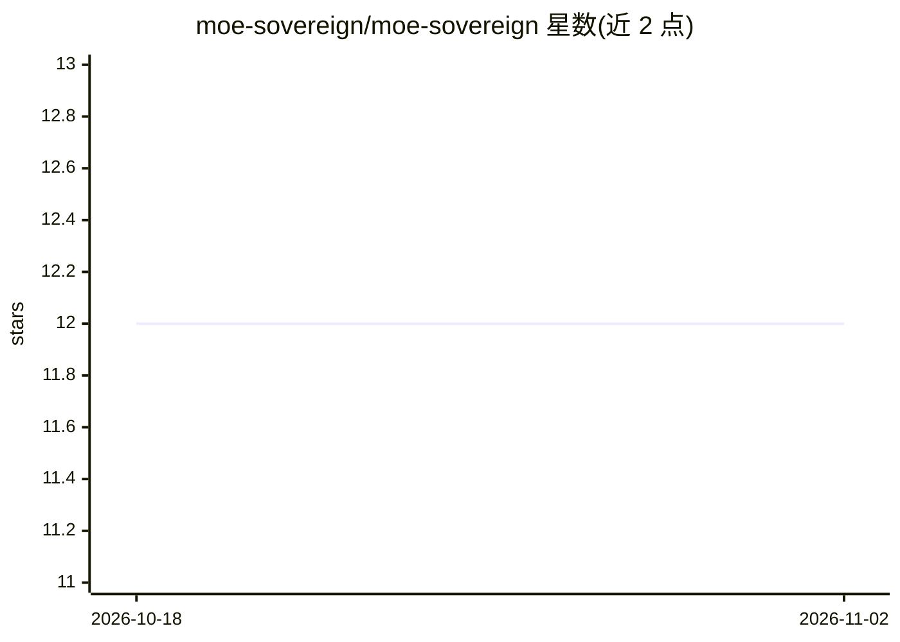

# moe-sovereign/moe-sovereign

⭐ 12 · Python · Apache-2.0 · 推送 2026-10-31 · [GitHub](https://github.com/moe-sovereign/moe-sovereign) · [官网](https://moe-sovereign.github.io/moe-sovereign/) · 组织维护

**自托管多模型编排器：模板化专家路由与主权环境 AI 基础设施**

面向数据主权场景的自托管多模型编排系统：以版本化模板做确定性专家路由，T1（≤20B）/T2（24–80B）两级模型按置信度分流，含 8 阶段流水线（缓存、规划、专家、MCP 工具、Neo4j GraphRAG、Judge、Agentic 重规划、知识回流）。提供 51 个 AST 白名单 MCP 精确工具、CAG 合规域直注入层、情景记忆与多租户 RBAC/API 预算管理。部署支持 LXC/Docker Compose/Podman rootless（已测试），Helm/K8s 为架构性准备、请求社区验证；Gradio/CUDA 等为可选配置。面向在自有硬件运行 LLM 基础设施的企业与机构用户。

## 筛选速览

| 维度 | 判定 | 备注 |
|---|---|---|
| AI 角色 | `ai-ecosystem` | LLM/agent 周边工具 |
| 许可风险 | `permissive` | Apache-2.0 |
| 部署形态 | `self-host` | docker 或自建部署 |
| 模型依赖 | local-ok | 支持本地模型 |
| 硬件要求 | — | 无带数字的原话,不猜 |
| 安装摩擦 | `low` | 无编译、无系统依赖或容器化 |
| 成熟度 | — | 结构信号不足 |

## 能力要点

- 版本化模板的确定性专家路由与 T1/T2 两级置信度升级
- 51 个 AST 白名单 MCP 精确工具（数学/法务/PPTX/学术检索等）
- Neo4j GraphRAG + CAG 合规层（BAIT/DORA/KRITIS 等静态域直注入）
- 多租户 RBAC、SSO（Authentik/OIDC）与 API 预算头管理

## 适用场景

- 在自有硬件上运行不依赖云 API 的多模型编排服务
- 对合规域（GDPR、DORA、KRITIS）文档做 GraphRAG 问答
- 通过 OpenAI Responses API / Anthropic 协议接入 Claude Code、Codex CLI 等客户端

## 场景标签

`Agent 框架` `多智能体` `模型网关` `知识图谱` · 领域:Agent 开发

## 证据(README 行号)

> L20: **MoE Sovereign** is a fully self-hosted multi-model orchestrator with template-based expert routing that runs enti
> L46: The orchestrator codebase is organised into focused packages. `main.py` is a thin entry point (~1 500 LOC) holding 
> L70: |**9**|Deployment Flexibility|One OCI image &rarr; LXC (tested), Docker Compose (tested), Podman rootless (tested),

## 星数曲线

2026-10-18 12 → 2026-11-02 12（+0）

---
*卡片 v1 · prompt 1.4 · 生成 2026-11-01 · 置信度 mid · 依据 README sha `9f4c815a3c42` · [字段定义](../../DATASET.md)*
