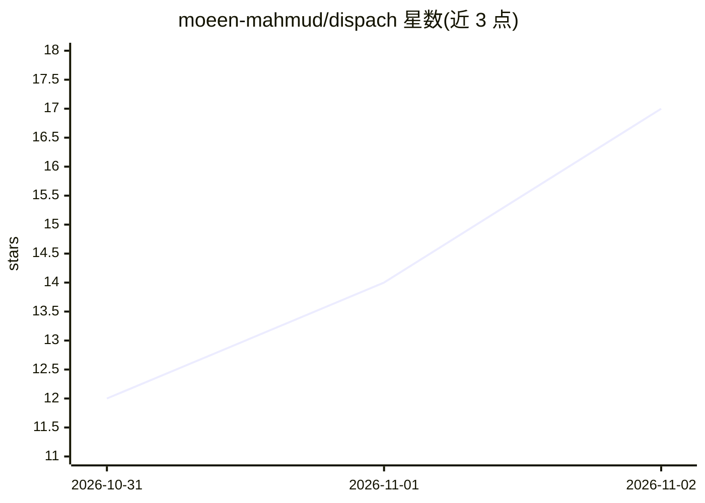

# moeen-mahmud/dispach

⭐ 17 · TypeScript · Apache-2.0 · 推送 2026-11-01 · [GitHub](https://github.com/moeen-mahmud/dispach) · [官网](https://dispach.blivius.com) · 个人维护

**自托管 HTTP agent 运行时：产品通过一个 API 运行带记忆与工具的 agent**

开源自托管的 agent 后端（TypeScript/Node，Apache-2.0）：产品后端通过 HTTP/SSE/WS 调用单一 API，运行多个各自带记忆、工具、调度、通道与审批的 agent，支持任意 OpenAI 兼容端点及 AWS Bedrock（可插拔传输）。机制包括：分离式可重连回合、幂等写、OpenAPI 3.1 契约、SQLite FTS5 记忆（不用嵌入）、渐进式压缩、MCP 作为工具提供方（非底座）、设置层自我修改防护（配套 arXiv 预印本测量）。提供 npm/Homebrew/Docker/独立安装脚本，Windows 需 WSL。0.2.0 的多人房间/代班功能标注为 experimental。明确不是编排图、工作流引擎、RAG 管道、向量库或模型网关。

## 筛选速览

| 维度 | 判定 | 备注 |
|---|---|---|
| AI 角色 | `ai-ecosystem` | LLM/agent 周边工具 |
| 许可风险 | `permissive` | Apache-2.0 |
| 部署形态 | `self-host` | docker 或自建部署 |
| 模型依赖 | local-ok | 支持本地模型 |
| 硬件要求 | — | 无带数字的原话,不猜 |
| 安装摩擦 | `low` | 无编译、无系统依赖或容器化 |
| 成熟度 | — | 结构信号不足 |

## 能力要点

- 单进程多 agent：分离式回合、幂等写、OpenAPI 3.1 契约、作用域密钥隔离
- 任意 OpenAI 兼容端点 + AWS Bedrock 可插拔传输 + 备选模型
- SQLite FTS5 记忆路径零模型依赖、零网络 I/O；五阶段渐进压缩
- 设置层自我修改防护（containment floor），配套 arXiv 预印本测量

## 适用场景

- 产品后端通过 HTTP API 运行带记忆与工具的 agent，部署在自己控制的基础设施上
- 接入本地或任意 OpenAI 兼容模型运行 agent 任务
- 多用户/多团队各自隔离的 agent 运行时（实验性）

## 场景标签

`Agent 框架` · 领域:Agent 开发

## 证据(README 行号)

> L8: **The agent backend your product calls over HTTP.** Open source and self-hosted: one API for agents
> L40: Your backend calls one API and Dispach runs the agents, each with its own memory and settings, on
> L123: - **Models:** any OpenAI-compatible endpoint, AWS Bedrock through a pluggable transport, fallback

## 星数曲线

2026-10-31 12 → 2026-11-02 17（+5）

---
*卡片 v1 · prompt 1.4 · 生成 2026-10-31 · 置信度 mid · 依据 README sha `f535140cd178` · [字段定义](../../DATASET.md)*
