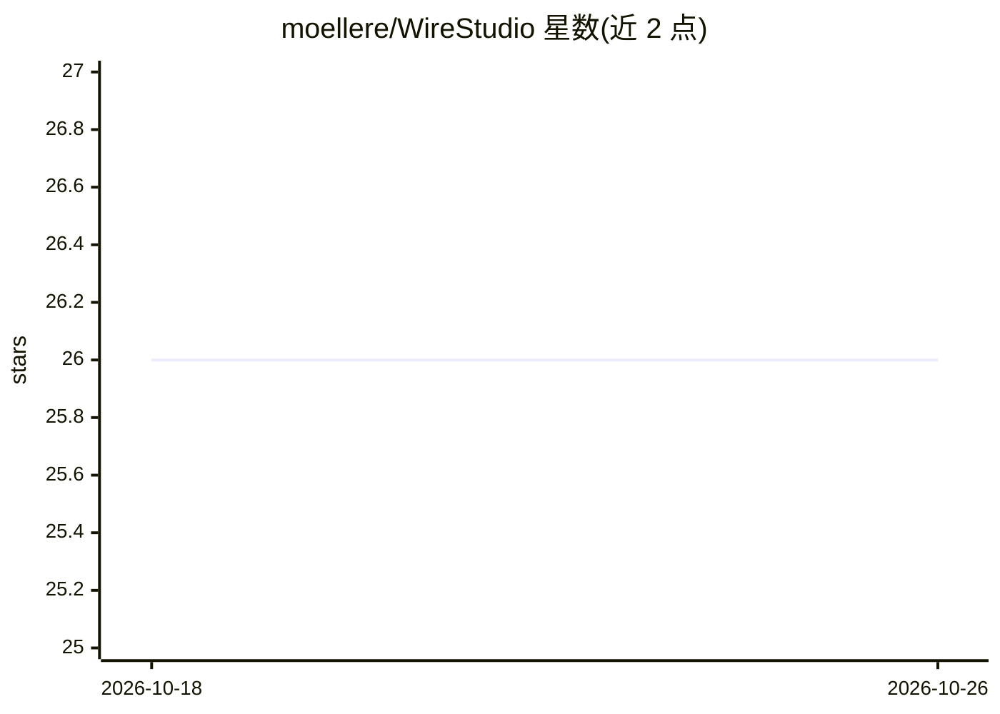

# moellere/WireStudio

⭐ 26 · Python · MIT · 推送 2026-10-25 · [GitHub](https://github.com/moellere/WireStudio) · [官网](https://wirestudio.io) · 个人维护

**面向 ESPHome/LoRaWAN 硬件的 AI 辅助设计工作台：从 design.json 生成全套硬件产物**

以单一 design.json（板卡+元件+连线）驱动硬件设计全流程的工具：CSP 求解器做引脚分配、电气规则校验（boot-strap/ADC2-WiFi/电压冲突），并扇出到 ESPHome YAML、ASCII 接线图、KiCad 原理图与已布局 PCB、JLCPCB 制造包（BOM/CPL/Gerber）、OpenSCAD 参数化外壳；还支持库内元件清单核对与替代件推荐。LoRaWAN 侧可构建/烧录 RadioLib 固件并对接 ChirpStack。可通过 Web UI、内置 agent 或任意 MCP 客户端驱动。限制：PCB 为已布局未布线（可选路由），LoRaWAN 目标限定 US915 频段。

## 筛选速览

| 维度 | 判定 | 备注 |
|---|---|---|
| AI 角色 | `ai-enhanced` | 去掉 AI 部分产品仍成立 |
| 许可风险 | `permissive` | MIT |
| 部署形态 | `self-host` | docker 或自建部署 |
| 模型依赖 | — | README 未给出锁定关系 |
| 硬件要求 | — | 无带数字的原话,不猜 |
| 安装摩擦 | `low` | 无编译、无系统依赖或容器化 |
| 成熟度 | — | 结构信号不足 |

## 能力要点

- 单一 design.json 驱动 YAML、原理图、PCB、制造包、3D 打印外壳全套产物
- CSP 引脚求解器与电气规则校验（boot-strap/ADC2-WiFi/电压冲突）
- 六种固件框架（ESPHome/Tasmota/LoRaWAN/Meshtastic/CircuitPython/MicroPython）统一 WebSerial 烧录
- MCP server 暴露设计、workbench、ChirpStack 与 fleet 构建工具，可被 Claude Code 等客户端驱动

## 适用场景

- 我从元件清单出发自动生成 ESPHome 配置、原理图与可下单的 PCB 制造包
- 我让 AI agent 或 MCP 客户端无头驱动从设计到 LoRaWAN 入网的全流程
- 我用抽屉里的散件库存核对我的设计并获取替代件建议

## 场景标签

 · 领域:硬件设计/IoT

## 证据(README 行号)

> L8: enclosure. Drive it from the web UI, the built-in agent, or any MCP
> L3: Hardware design tool for ESPHome devices. A single `design.json`

## 星数曲线

2026-10-18 26 → 2026-10-26 26（+0）

---
*卡片 v1 · prompt 1.4 · 生成 2026-10-26 · 置信度 low · 依据 README sha `cc05432d43ae` · [字段定义](../../DATASET.md)*
