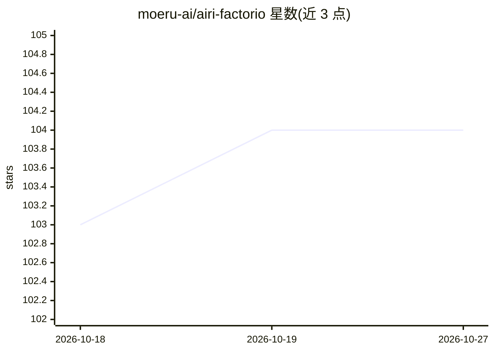

# moeru-ai/airi-factorio

⭐ 104 · TypeScript · MIT · 推送 2026-02-25 · [GitHub](https://github.com/moeru-ai/airi-factorio) · 组织维护

**让 AI 通过 CV 与 LLM 自动游玩 Factorio 的游戏智能体**

Project AIRI 的子项目，目标是构建由 LLM 与 AI 驱动、能实时语音对话并游玩 Minecraft/Factorio 的智能体；本仓库实现其中游玩 Factorio 的部分，结合 YOLO 视觉识别与 LLM 决策，通过 autorio Factorio 自动化模组与 RCON 通信控制游戏。开发流程为：克隆仓库、pnpm 安装依赖、符号链接 autorio 模组到 Factorio 数据目录、填写 .env 配置、创建存档后运行 pnpm run dev。需要本地已安装 Factorio。

## 筛选速览

| 维度 | 判定 | 备注 |
|---|---|---|
| AI 角色 | `ai-native` | 本体是模型或模型工具 |
| 许可风险 | `permissive` | MIT |
| 部署形态 | `library` | 以包/库形式分发 |
| 模型依赖 | — | README 未给出锁定关系 |
| 硬件要求 | — | 无带数字的原话,不猜 |
| 安装摩擦 | `low` | 无编译、无系统依赖或容器化 |
| 成熟度 | — | 结构信号不足 |

## 能力要点

- YOLO 视觉识别与 LLM 决策结合驱动游戏行为
- 通过 autorio 自动化模组与 Factorio RCON 接口控制游戏
- TypeScript monorepo 结构，提供 DevContainer 与 box64 非x64 机器路径

## 适用场景

- 研究 LLM+CV 智能体在开放工厂游戏中的自动化表现
- 作为 Project AIRI 智能体的游戏游玩能力组件进行开发扩展
- 参考其 Factorio 自动化模组与 RCON 封装实现自己的游戏 AI

## 场景标签

 · 领域:游戏/智能体

## 证据(README 行号)

> L5: > This project is part of the Project AIRI, we aim to build a wishing to achieve Neuro-sama's (subscribe if you didn
> L87: Thanks for the original idea and code: https://github.com/naklecha/factorio-automation

## 星数曲线

2026-10-18 103 → 2026-10-27 104（+1）

---
*卡片 v1 · prompt 1.4 · 生成 2026-10-23 · 置信度 high · 依据 README sha `2645e3bd0def` · [字段定义](../../DATASET.md)*
