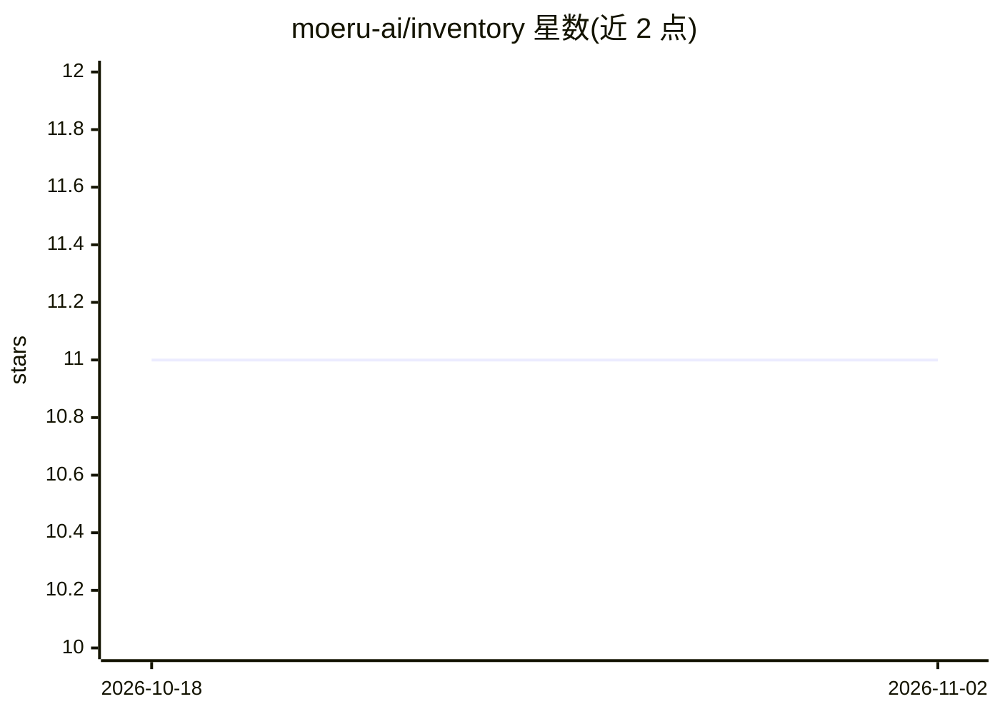

# moeru-ai/inventory

⭐ 11 · Go · MIT · 推送 2026-01-13 · [GitHub](https://github.com/moeru-ai/inventory) · [官网](https://inventory.moeru.ai/apis/docs/v1) · 组织维护

**通用模型目录服务：聚合各处模型信息，提供 HTTP/gRPC API**

moeru-ai 维护的模型目录服务（v0.0.1），以 Go 编写，构建后作为独立 API 服务器运行，同时提供 HTTP（7921 端口）与 gRPC（7922 端口）接口，可查询按通用任务组织的模型列表。无需 config 文件，全部通过环境变量配置，需要 OPENAI_API_KEY 与 VOYAGE_API_KEY。提供公开实例 inventory.moeru.ai 及在线 API 文档。构建需 Go 1.23+，通过 git clone 源码自行编译运行。

## 筛选速览

| 维度 | 判定 | 备注 |
|---|---|---|
| AI 角色 | `ai-ecosystem` | LLM/agent 周边工具 |
| 许可风险 | `permissive` | MIT |
| 部署形态 | `None` |  |
| 模型依赖 | — | README 未给出锁定关系 |
| 硬件要求 | — | 无带数字的原话,不猜 |
| 安装摩擦 | `low` | 无编译、无系统依赖或容器化 |
| 成熟度 | — | 结构信号不足 |

## 能力要点

- 提供模型目录的 HTTP 与 gRPC 双 API 服务
- 按通用任务（common-tasks）组织模型列表
- 环境变量配置，无需 config 文件
- 提供公开实例与在线 API 文档

## 适用场景

- 查询各提供商在通用任务下的模型清单
- 通过 API 集成模型目录数据到自己的应用
- 自托管模型目录服务供内部系统调用

## 场景标签

 · 领域:LLM 基础设施/模型信息

## 证据(README 行号)

> L3: > Your universal model catalog, everything, everywhere, all at once.
> L10: curl -L -X GET -v 'https://inventory.moeru.ai/api/v1/common-tasks/models' | jq

## 星数曲线

2026-10-18 11 → 2026-11-02 11（+0）

---
*卡片 v1 · prompt 1.4 · 生成 2026-11-02 · 置信度 mid · 依据 README sha `3e0af9306ce1` · [字段定义](../../DATASET.md)*
