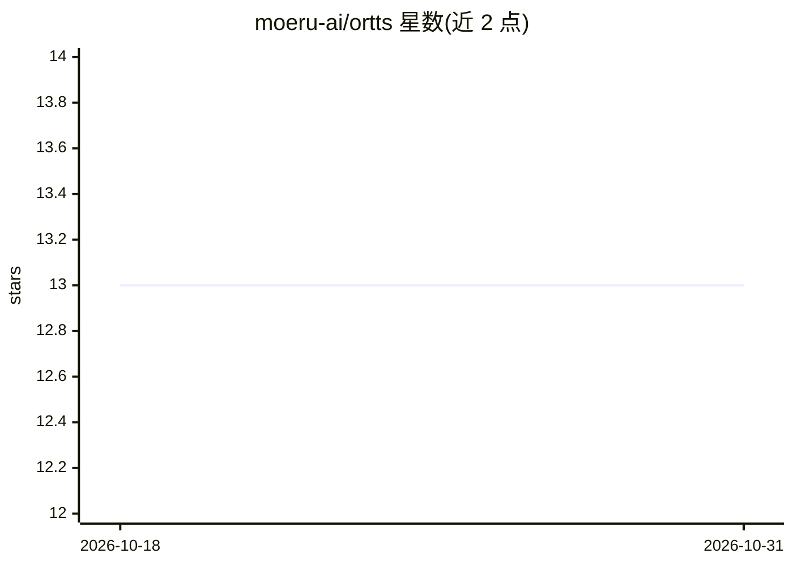

# moeru-ai/ortts

⭐ 13 · Rust · MIT · 推送 2026-09-18 · [GitHub](https://github.com/moeru-ai/ortts) · 组织维护

**本地 TTS 推理服务器：ONNX Runtime 驱动，OpenAI 兼容接口**

用 Rust 编写的本地文本转语音推理服务器，基于 ONNX Runtime 运行，对外提供 OpenAI 兼容的 /v1/audio/speech API。支持 Chatterbox Multilingual、Kokoro、Qwen3-TTS 0.6B Base 三个后端；Qwen3-TTS Base 用 voice 字段传本地参考音频路径，并以 model 名后缀选择语言。支持从源码 cargo 运行（Linux 上由 Pixi 安装 CUDA 12 运行时供 ONNX Runtime 使用）、Docker 部署（可挂载 Hugging Face 缓存复用模型），内置 Scalar OpenAPI 文档，MIT 许可。

## 筛选速览

| 维度 | 判定 | 备注 |
|---|---|---|
| AI 角色 | `ai-ecosystem` | LLM/agent 周边工具 |
| 许可风险 | `permissive` | MIT |
| 部署形态 | `self-host` | docker 或自建部署 |
| 模型依赖 | — | README 未给出锁定关系 |
| 硬件要求 | — | 无带数字的原话,不猜 |
| 安装摩擦 | `low` | 无编译、无系统依赖或容器化 |
| 成熟度 | — | 结构信号不足 |

## 能力要点

- OpenAI 兼容的 /v1/audio/speech 接口
- Chatterbox Multilingual / Kokoro / Qwen3-TTS 0.6B 三种后端
- 基于 ONNX Runtime 的本地推理，Rust 实现
- Docker 镜像支持挂载 Hugging Face 模型缓存

## 适用场景

- 在本地或自有服务器上运行 TTS 服务，替代云端 API
- 用 OpenAI 兼容接口接入现有应用的语音合成
- 通过参考音频做声音克隆式合成（Qwen3-TTS）

## 场景标签

`语音合成` · 领域:内容生成

## 证据(README 行号)

> L3: `ortts` is an OpenAI-compatible server offering text-to-speech services.
> L5: ## Backends

## 星数曲线

2026-10-18 13 → 2026-10-31 13（+0）

---
*卡片 v1 · prompt 1.4 · 生成 2026-10-31 · 置信度 high · 依据 README sha `c17562551d39` · [字段定义](../../DATASET.md)*
