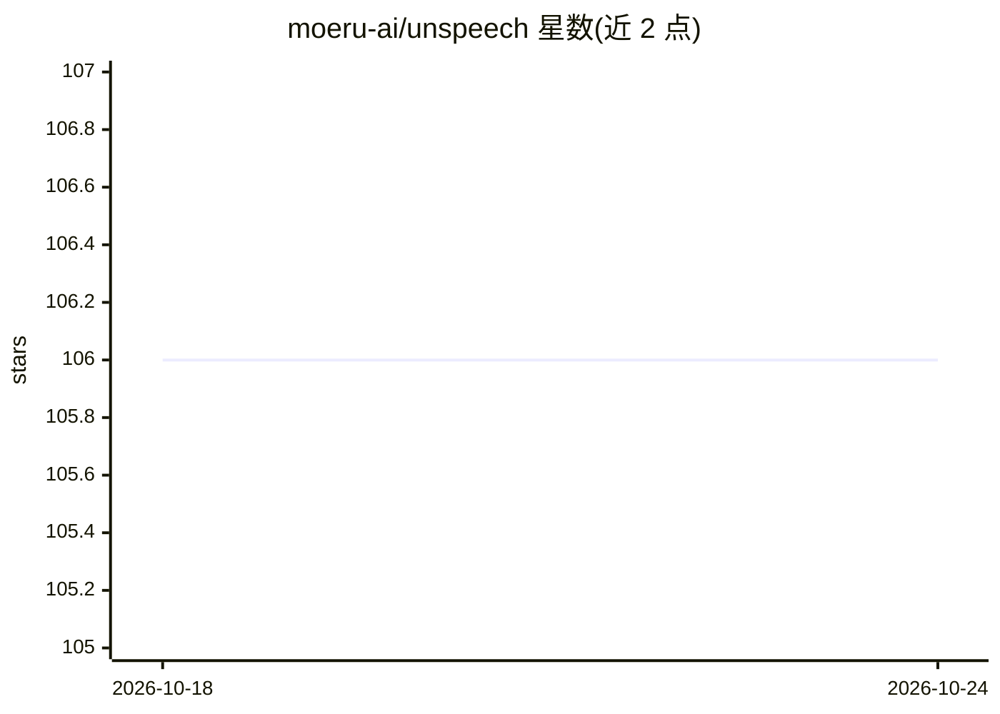

# moeru-ai/unspeech

⭐ 106 · Go · AGPL-3.0 · 推送 2026-10-19 · [GitHub](https://github.com/moeru-ai/unspeech) · 组织维护

**统一多家在线 TTS 服务的 OpenAI 兼容 API 网关**

unSpeech 是一个用 Go 编写的自托管服务，将 OpenAI、Azure AI Speech、Deepgram、阿里云百炼、火山引擎、ElevenLabs、Fish Audio、MiniMax 等 10 家在线语音合成服务统一为 OpenAI 兼容的 /v1/audio/speech 接口。model 参数采用 provider/model 格式指定后端，Authorization 头自动转换为目标厂商的鉴权方式（如 xi-api-key），可直接配合现有 OpenAI 客户端使用。构建需 Go 1.24+，从源码 git clone 后编译运行，默认监听 5933 端口。采用 AGPL-3.0 许可。

## 筛选速览

| 维度 | 判定 | 备注 |
|---|---|---|
| AI 角色 | `ai-ecosystem` | LLM/agent 周边工具 |
| 许可风险 | `viral` | AGPL-3.0 |
| 部署形态 | `None` |  |
| 模型依赖 | — | README 未给出锁定关系 |
| 硬件要求 | — | 无带数字的原话,不猜 |
| 安装摩擦 | `low` | 无编译、无系统依赖或容器化 |
| 成熟度 | — | 结构信号不足 |

## 能力要点

- 支持 10 家在线 TTS 服务商，统一为 OpenAI 兼容 API
- Authorization 头自动转换为厂商对应鉴权方式
- model 参数格式 provider/model 指定后端
- Go 编写的自托管 HTTP 服务，默认端口 5933

## 适用场景

- 让现有 OpenAI 客户端代码无需改动即可调用多家 TTS 服务
- 在应用中按需切换不同语音合成供应商
- 自建统一的语音合成接入层

## 场景标签

`语音合成` `模型网关` · 领域:Agent 开发

## 证据(README 行号)

> L7: unSpeech lets you use various online TTS with OpenAI-compatible API.
> L25: The `model` parameter should be provider + model, e.g. `openai/tts-1-hd`, `elevenlabs/eleven_multilingual_v2`.

## 星数曲线

2026-10-18 106 → 2026-10-24 106（+0）

---
*卡片 v1 · prompt 1.4 · 生成 2026-10-23 · 置信度 high · 依据 README sha `56146f7f8933` · [字段定义](../../DATASET.md)*
