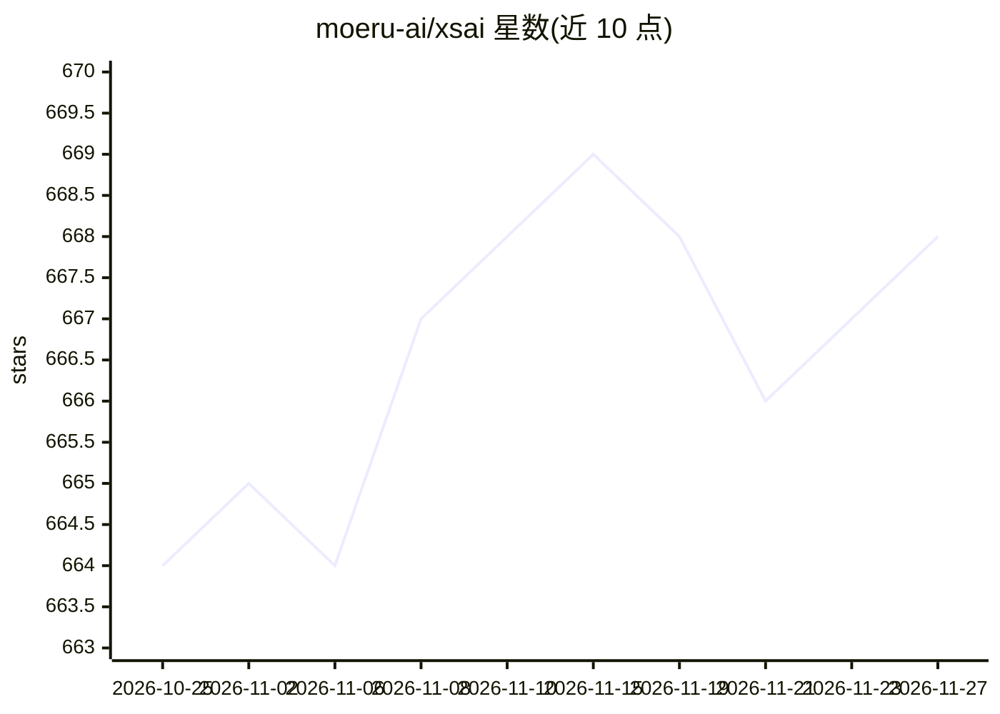

# moeru-ai/xsai

⭐ 668 · TypeScript · MIT · 推送 2026-11-20 · [GitHub](https://github.com/moeru-ai/xsai) · [官网](https://xsai.js.org) · 组织维护

**给开发者的超小型 TypeScript AI SDK，按协议适配多家模型服务**

面向 JavaScript/TypeScript 开发者的 AI SDK，以协议而非厂商为单位提供适配器：OpenAI Responses、Chat Completions、Anthropic Messages 三种协议各一个包，同一套 generateText/streamText 与工具调用接口可切换任何讲同协议的服务或网关。各包为无副作用 ES module，可被 tree-shaking；全栈基于 fetch、ReadableStream 等 Web 标准，可在 Node.js、Deno、Bun、Cloudflare Workers 与浏览器运行；类型端到端覆盖，schema 遵循 Standard Schema。

## 筛选速览

| 维度 | 判定 | 备注 |
|---|---|---|
| AI 角色 | `ai-ecosystem` | LLM/agent 周边工具 |
| 许可风险 | `permissive` | MIT |
| 部署形态 | `library` | 以包/库形式分发 |
| 模型依赖 | — | README 未给出锁定关系 |
| 硬件要求 | — | 无带数字的原话,不猜 |
| 安装摩擦 | `low` | 无编译、无系统依赖或容器化 |
| 成熟度 | — | 结构信号不足 |

## 能力要点

- 每个协议一个适配器，换服务不改代码
- 仅依赖 fetch/ReadableStream 等 Web 标准，源码不导入 Node.js 模块
- 子包拆分：文本、语音/转录、嵌入、图像生成、模型列表等按需安装
- 端到端 TypeScript 类型，schema 兼容 Standard Schema

## 适用场景

- 在多个模型服务之间切换而不改调用代码
- 在 Workers/Deno/Bun 等无 Node 环境运行 LLM 调用
- 按需引入嵌入、转录或图像生成能力以减小打包体积

## 场景标签

 · 领域:LLM 基础设施/SDK

## 证据(README 行号)

> L5: **AI SDK, extra small.**
> L41: - **A model belongs to a protocol, not to a provider.** One adapter covers every service that speaks the same proto
> L47: xsAI does not ship a package for each provider. It ships an adapter for each protocol, and many services and gatewa

## 星数曲线

2026-10-25 664 → 2026-11-27 668（+4）

---
*卡片 v1 · prompt 1.4 · 生成 2026-11-24 · 置信度 high · 依据 README sha `6590d4fa32d4` · [字段定义](../../DATASET.md)*
