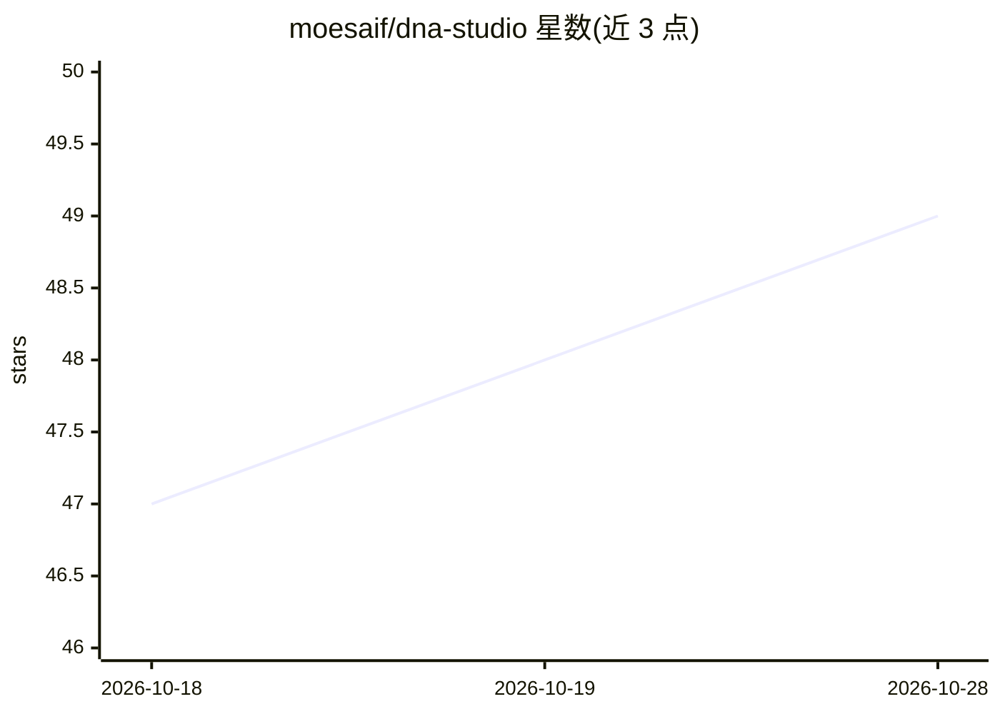

# moesaif/dna-studio

⭐ 49 · TypeScript · MIT · 推送 2026-09-07 · [GitHub](https://github.com/moesaif/dna-studio) · 个人维护

**自托管的 AI 营销平台：从网站 URL 提取品牌画像并生成发布社媒内容**

面向需要自托管营销工具的用户：粘贴网站 URL，Playwright 抓取站点并提取品牌 DNA（颜色、字体、语气、受众、行业），AI 据此为 Instagram/LinkedIn/Facebook/X 生成各平台规范的内容，经 OAuth 连接账号后可直接发布或通过 BullMQ 队列定时发布。另提供 AI 商品照生成（29 模板）、图像生成（DALL-E/Gemini/Stability/Replicate）与 UGC 视频生成（Veo/HeyGen/D-ID）。LLM 提供商可切换 OpenAI/Anthropic/Gemini/Ollama，单一环境变量即可切换。Docker Compose 一条命令部署，需 PostgreSQL 与 Redis，MIT 许可。

## 筛选速览

| 维度 | 判定 | 备注 |
|---|---|---|
| AI 角色 | `ai-native` | 本体是模型或模型工具 |
| 许可风险 | `permissive` | MIT |
| 部署形态 | `self-host` | docker 或自建部署 |
| 模型依赖 | local-ok | 支持本地模型 |
| 硬件要求 | — | 无带数字的原话,不猜 |
| 安装摩擦 | `low` | 无编译、无系统依赖或容器化 |
| 成熟度 | — | 结构信号不足 |

## 能力要点

- 从任意 URL 提取品牌 DNA（颜色/字体/语气/受众/行业）
- 多平台内容生成并支持 OAuth 直发与定时发布（BullMQ）
- LLM 提供商可切换：OpenAI/Anthropic/Gemini/Ollama
- AI 商品照（29 模板）、图像生成与 UGC 视频生成

## 适用场景

- 从品牌网站一键生成并发布多平台社媒营销内容
- 自托管环境下的营销内容生产，数据留在自己基础设施
- 用本地 Ollama 模型免 API key 进行开发与生成

## 场景标签

`AI 写作` `图像生成` `视频生成` · 领域:内容生成

## 证据(README 行号)

> L22: DNA Studio analyzes any website URL to extract a **Brand DNA** profile — colors, fonts, tone of voice, target audie
> L34: - **Multi-Platform Campaign Generation** — Generate platform-specific content for Instagram, LinkedIn, Facebook, an

## 星数曲线

2026-10-18 47 → 2026-10-28 49（+2）

---
*卡片 v1 · prompt 1.4 · 生成 2026-10-25 · 置信度 mid · 依据 README sha `f0e4fc1e73b1` · [字段定义](../../DATASET.md)*
