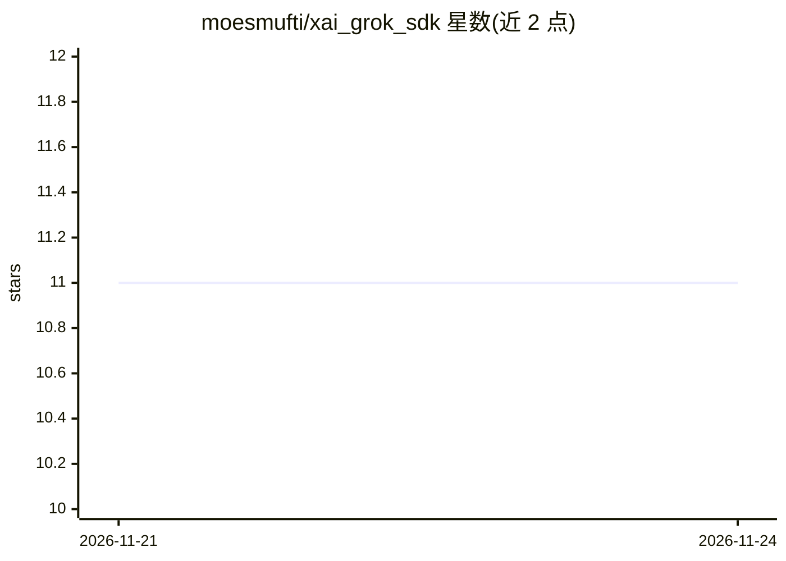

# moesmufti/xai_grok_sdk

⭐ 11 · Python · MIT · 推送 2026-11-20 · [GitHub](https://github.com/moesmufti/xai_grok_sdk) · [官网](https://pypi.org/project/xai-grok-sdk/) · 个人维护

**为 Python 开发者提供的 xAI Grok API 客户端 SDK**

对接 xAI Grok API 的轻量 Python SDK，仅依赖 requests。提供聊天补全、流式响应、函数调用（auto/required/none 三种 tool_choice 模式及 function_map 本地执行）、结构化 JSON 输出与 API key 环境变量管理等封装。当前支持 grok-2-1212 与 grok-beta 两个文本模型，流式模式下不支持 response_format 与工具调用。README 明确声明项目不再积极维护。

## 筛选速览

| 维度 | 判定 | 备注 |
|---|---|---|
| AI 角色 | `ai-ecosystem` | LLM/agent 周边工具 |
| 许可风险 | `permissive` | MIT |
| 部署形态 | `library` | 以包/库形式分发 |
| 模型依赖 | locked-api |  |
| 硬件要求 | — | 无带数字的原话,不猜 |
| 安装摩擦 | `low` | 无编译、无系统依赖或容器化 |
| 成熟度 | — | 结构信号不足 |

## 能力要点

- 聊天补全、流式输出与结构化 JSON 输出
- 函数调用支持 auto/required/none 模式与 function_map 本地实现
- 仅依赖 requests，支持自定义 base URL
- 内置请求参数校验与错误处理

## 适用场景

- 在 Python 项目中调用 Grok 模型生成文本
- 给 LLM 挂载本地函数做工具调用
- 需要固定 JSON Schema 的结构化模型输出

## 场景标签

 · 领域:LLM 基础设施/API 客户端

## 证据(README 行号)

> L5: A lightweight Python SDK for interacting with the xAI API, designed with minimal dependencies. All you need is your 
> L17: - Simple and intuitive interface for xAI API interactions
> L141: The main class for interacting with the xAI API.

## 星数曲线

2026-11-21 11 → 2026-11-24 11（+0）

---
*卡片 v1 · prompt 1.4 · 生成 2026-11-21 · 置信度 high · 依据 README sha `c5f578a889e6` · [字段定义](../../DATASET.md)*
