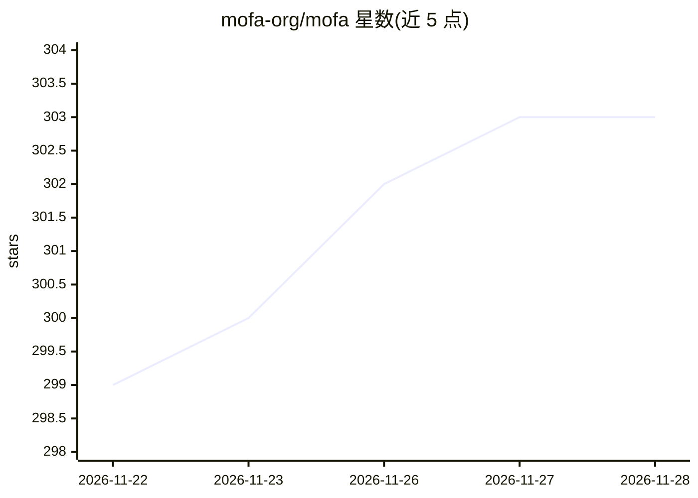

# mofa-org/mofa

⭐ 303 · Rust · Apache-2.0 · 推送 2026-11-21 · [GitHub](https://github.com/mofa-org/mofa) · [官网](https://mofa.ai) · 组织维护 · 中文 README

**面向企业的 Agent 运行时与计费计量一体化 LLM 基础设施**

MoFA（Modular Framework for Agents）以 Rust 微内核为核心，通过 UniFFI 生成 Python/Java/Go/Kotlin/Swift 多语言绑定，提供插件化的 agent 运行时、OpenAI 兼容网关、按用户/租户的 token 计量审计与配额控制。企业用它作为统一基础设施承载业务 AI 集成，链路覆盖 agent runtime → token metering & audit → credits → billing → recharge。扩展机制为双层插件（编译期 Rust/WASM + 运行期 Rhai 热加载脚本），配合 Ractor Actor 并发、Raft 分布式共识、Prometheus/OpenTelemetry 可观测，数据持久化支持 PostgreSQL/MySQL/SQLite。credits、账单与充值通道目前标注为规划中。

## 筛选速览

| 维度 | 判定 | 备注 |
|---|---|---|
| AI 角色 | `ai-ecosystem` | LLM/agent 周边工具 |
| 许可风险 | `permissive` | Apache-2.0 |
| 部署形态 | `library` | 以包/库形式分发 |
| 模型依赖 | — | README 未给出锁定关系 |
| 硬件要求 | — | 无带数字的原话,不猜 |
| 安装摩擦 | `low` | 无编译、无系统依赖或容器化 |
| 成熟度 | — | 结构信号不足 |

## 能力要点

- Rust 微内核 + 双层插件系统（编译期 Rust/WASM、运行期 Rhai 热加载）
- 按用户/租户的 token 计量与审计，账目落库 PostgreSQL/MySQL/SQLite
- UniFFI 多语言绑定：Python/Java/Go/Kotlin/Swift
- OpenAI 兼容网关、负载均衡、限流与 Raft 分布式协调

## 适用场景

- 企业向自己的终端用户交付 agent 能力并完成计量计费闭环
- 用脚本热更新业务规则与工作流，无需重新编译
- 自托管部署多语言调用的 agent 运行时
- 对每次 LLM 调用做用户级成本核算与预算控制

## 场景标签

`Agent 框架` `模型网关` · 领域:Agent 开发

## 证据(README 行号)

> L42: MoFA (Modular Framework for Agents) is enterprise-grade LLM infrastructure.
> L43: Enterprises use MoFA to deliver agent capabilities for business AI integration, while MoFA runs the complete chain 

## 星数曲线

2026-11-22 299 → 2026-11-28 303（+4）

---
*卡片 v1 · prompt 1.4 · 生成 2026-11-22 · 置信度 high · 依据 README sha `961251113504` · [字段定义](../../DATASET.md)*
