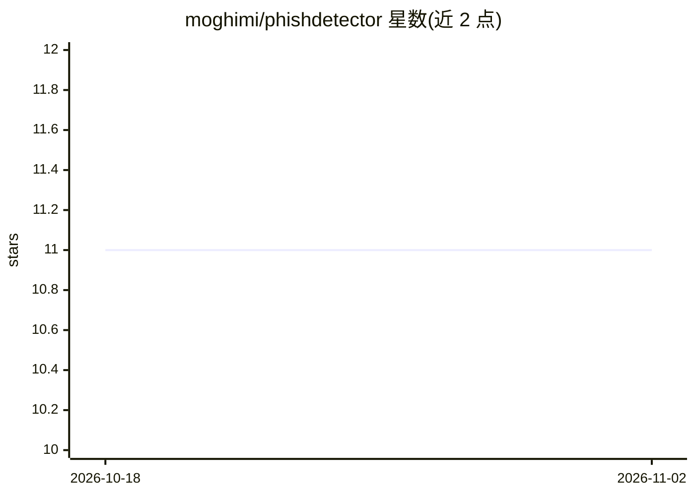

# moghimi/phishdetector

⭐ 11 · JavaScript · MIT · 推送 2026-09-03 · [GitHub](https://github.com/moghimi/phishdetector) · [官网](https://chrome.google.com/webstore/detail/kgecldbalfgmgelepbblodfoogmjdgmj) · 个人维护

**检测网银钓鱼页面的 Chrome 扩展（规则分析）**

Google Chrome 浏览器扩展，面向网银用户：用户点击扩展图标打开弹窗时，读取并分析当前网页内容，以规则方式识别钓鱼攻击。README 声明扩展不收集、不传输、不共享用户数据，仅读取页面内容进行分析。主题标签含 machine-learning 与 svm-classifier，但正文自述为规则系统。发布于 Chrome 商店，本仓库为其开源版本，采用 MIT 许可。

## 筛选速览

| 维度 | 判定 | 备注 |
|---|---|---|
| AI 角色 | `ai-native` | 本体是模型或模型工具 |
| 许可风险 | `permissive` | MIT |
| 部署形态 | `None` |  |
| 模型依赖 | — | README 未给出锁定关系 |
| 硬件要求 | — | 无带数字的原话,不猜 |
| 安装摩擦 | `low` | 无编译、无系统依赖或容器化 |
| 成熟度 | — | 结构信号不足 |

## 能力要点

- 用户点击图标时读取并分析页面内容
- 面向网银页面的钓鱼检测
- 声明不收集、传输或共享用户数据

## 适用场景

- 网购/网银操作前检查当前页面是否为钓鱼站点
- 作为浏览器扩展在 Chrome 中按需运行检测

## 场景标签

`网络安全` · 领域:学习与行业

## 证据(README 行号)

> L3: PhishDetector is a powerful extension which detects phishing attacks in online banking web sites. It is a rule-based
> L13: The extension analyzes page content to detect phishing attack when user opens the extension's popup page by clickin

## 星数曲线

2026-10-18 11 → 2026-11-02 11（+0）

---
*卡片 v1 · prompt 1.4 · 生成 2026-11-02 · 置信度 mid · 依据 README sha `ab458ce0d083` · [字段定义](../../DATASET.md)*
