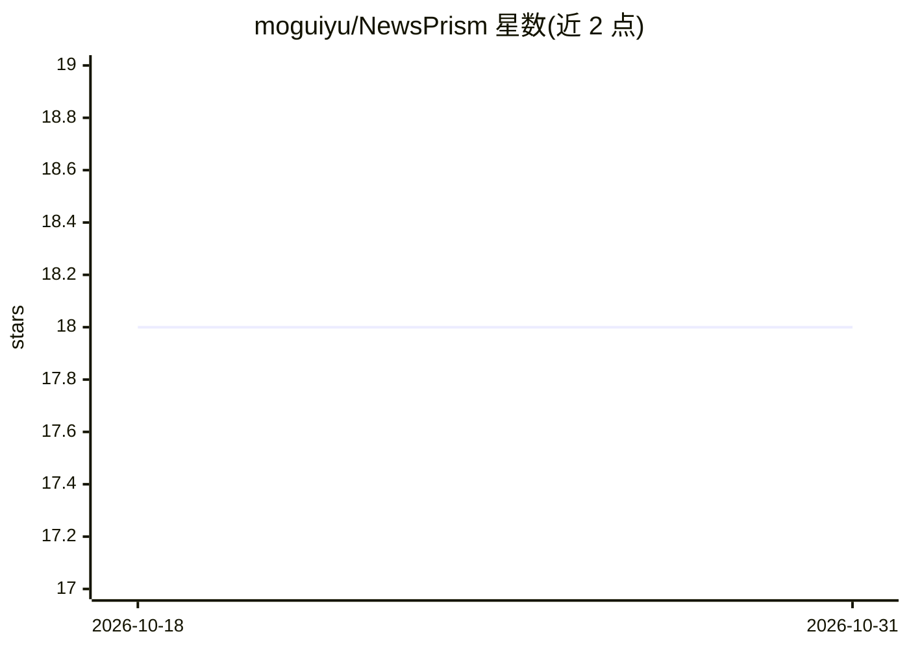

# moguiyu/NewsPrism

⭐ 18 · Python · MIT · 推送 2026-10-29 · [GitHub](https://github.com/moguiyu/NewsPrism) · [官网](https://news.moguiyu.top) · 个人维护 · 中文 README

**自托管多语新闻聚合分析器：同一事件跨源聚类生成中文日报**

面向自托管用户的多语新闻监测工具：从 12 个国家 46 个来源采集文章，经 LLM 事件聚类、多维影响评估与角度摘要，产出中文跨来源事件的静态 HTML 日报，展示不同媒体的报道框架。支持编辑 👍/👎 反馈的每周权重校准、国家媒体分级门控、好消息栏目。通过 Docker Compose 或源码部署，LLM 经 LiteLLM 接入任意 OpenAI 兼容服务，SQLite 单机持久化，不支持多写集群。

## 筛选速览

| 维度 | 判定 | 备注 |
|---|---|---|
| AI 角色 | `ai-native` | 本体是模型或模型工具 |
| 许可风险 | `permissive` | MIT |
| 部署形态 | `self-host` | docker 或自建部署 |
| 模型依赖 | — | README 未给出锁定关系 |
| 硬件要求 | — | 无带数字的原话,不猜 |
| 安装摩擦 | `low` | 无编译、无系统依赖或容器化 |
| 成熟度 | — | 结构信号不足 |

## 能力要点

- LLM 事件聚类（单次调用，含嵌入回退）将同一事件跨源分组
- 多维影响评估排序 + 编辑反馈每周自校准权重
- 7 级国家媒体分级门控与中文跨源日报
- 提供 CLI（collect/publish/replay/scheduler/校准/反馈门户）

## 适用场景

- 自建服务器每日生成跨来源中文新闻日报
- 比较同一事件下不同媒体的报道角度
- 通过编辑反馈让选题权重随时间校准

## 场景标签

`网页抓取` `AI 写作` · 领域:效率与自动化

## 证据(README 行号)

> L3: NewsPrism is a self-hosted news analysis tool built around one idea: the same event, read from many directions, gets
> L5: It collects the same stories from 46 sources across 12 countries and languages, groups them by real-world event, and
> L19: - LLM-driven event clustering (single API call) groups articles by real-world event identity, not just topic overla

## 星数曲线

2026-10-18 18 → 2026-10-31 18（+0）

---
*卡片 v1 · prompt 1.4 · 生成 2026-10-29 · 置信度 high · 依据 README sha `00016bb87cdc` · [字段定义](../../DATASET.md)*
