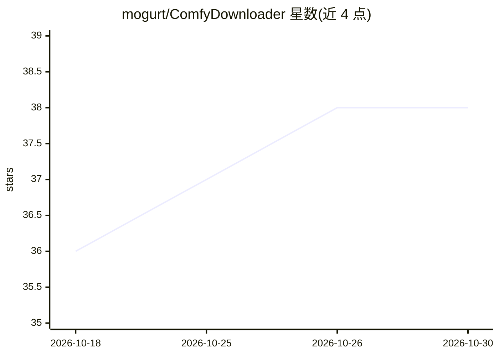

# mogurt/ComfyDownloader

⭐ 38 · TypeScript · MIT · 推送 2026-09-30 · [GitHub](https://github.com/mogurt/ComfyDownloader) · 个人维护 · 中文 README

**为 ComfyUI 用户下载与管理 AI 模型的跨平台桌面应用**

基于 Tauri v2（Rust）与 React 的桌面应用，解决 ComfyUI 模型管理环节：在单一应用内搜索 Hugging Face 与 Civitai，解析 URL 并推荐模型类型，把下载自动路由到 ComfyUI 对应子目录；下载引擎为内嵌 aria2c，支持并发、断点续传与去重。还可解析 ComfyUI workflow JSON，检查本地缺失模型，并校验运行中的 ComfyUI 是否识别已下载模型。macOS（Apple Silicon/Intel）与 Windows 提供预编译安装包，Linux 打包尚未官方支持；构建未代码签名，需自行校验 SHA256。

## 筛选速览

| 维度 | 判定 | 备注 |
|---|---|---|
| AI 角色 | `ai-ecosystem` | LLM/agent 周边工具 |
| 许可风险 | `permissive` | MIT |
| 部署形态 | `desktop` | 安装包/桌面程序 |
| 模型依赖 | — | README 未给出锁定关系 |
| 硬件要求 | — | 无带数字的原话,不猜 |
| 安装摩擦 | `low` | 无编译、无系统依赖或容器化 |
| 成熟度 | `idea` | |

## 能力要点

- 聚合搜索 Hugging Face 与 Civitai，统一桌面端下载入口
- URL/文件名/元数据驱动的模型类型推荐与目录自动路由
- 内嵌 aria2c 下载引擎：并发、断点续传、实时进度、重复检测
- workflow JSON 解析与本地缺失模型检查，及运行中 ComfyUI 的识别校验

## 适用场景

- 为 ComfyUI 工作流下载模型并自动放入正确子目录
- 分析 workflow 文件，找出本地还缺哪些模型
- 在防火墙环境下经 HTTP/SOCKS5 代理批量下载模型

## 场景标签

 · 领域:AI 模型管理/工具

## 证据(README 行号)

> L5: A desktop application for downloading AI models to the correct ComfyUI directories, powered by aria2.
> L51: - **ComfyUI integration** - Verify models are recognized by a running ComfyUI instance
> L52: - **Workflow parser** - Analyze ComfyUI workflow JSON and check which models are missing locally

## 星数曲线

2026-10-18 36 → 2026-10-30 38（+2）

---
*卡片 v1 · prompt 1.4 · 生成 2026-10-25 · 置信度 high · 依据 README sha `0555911f545f` · [字段定义](../../DATASET.md)*
