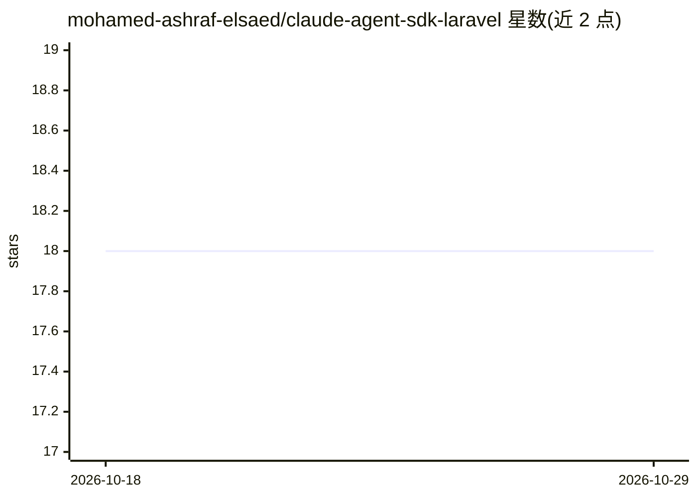

# mohamed-ashraf-elsaed/claude-agent-sdk-laravel

⭐ 18 · PHP · MIT · 推送 2026-04-15 · [GitHub](https://github.com/mohamed-ashraf-elsaed/claude-agent-sdk-laravel) · [官网](https://packagist.org/packages/mohamed-ashraf-elsaed/claude-agent-sdk-laravel) · 个人维护

**PHP/Laravel 封装 Claude Code CLI 的 Agent SDK**

面向 Laravel 开发者的 Composer 包，将 Claude Code CLI 包装为 PHP 库，使应用可调用文件操作、bash 命令、代码编辑、web 搜索等工具能力。SDK 提供流式响应、12 种 hook 事件、子代理定义、MCP 服务器接入（stdio/SSE 等）、结构化 JSON 输出、会话恢复、沙箱隔离与进程中断控制。运行需 PHP 8.1+、Laravel 10-13、全局安装的 Claude Code CLI 与 Anthropic API key。

## 筛选速览

| 维度 | 判定 | 备注 |
|---|---|---|
| AI 角色 | `ai-ecosystem` | LLM/agent 周边工具 |
| 许可风险 | `permissive` | MIT |
| 部署形态 | `library` | 以包/库形式分发 |
| 模型依赖 | locked-api |  |
| 硬件要求 | — | 无带数字的原话,不猜 |
| 安装摩擦 | `low` | 无编译、无系统依赖或容器化 |
| 成熟度 | — | 结构信号不足 |

## 能力要点

- 通过 Fluent Builder 配置工具白名单/黑名单与权限模式（5 种）
- 12 种 hook 事件与自定义权限回调（可修改工具输入）
- 子代理委托、MCP 服务器接入与结构化 JSON 输出
- 沙箱隔离、stderr 监控与进程中断/生命周期控制

## 适用场景

- 在 Laravel 应用中构建使用工具的 Claude agent
- 通过 MCP 协议给 agent 接入外部工具
- 以 schema 校验的方式获取结构化 agent 输出
- 跨多次请求维持 agent 会话上下文

## 场景标签

`Agent 框架` · 领域:Agent 开发

## 证据(README 行号)

> L10: Build AI agents with Claude Code as a library in your Laravel applications. This SDK wraps the Claude Code CLI to g
> L16: - Claude Code CLI (`npm install -g @anthropic-ai/claude-code`)

## 星数曲线

2026-10-18 18 → 2026-10-29 18（+0）

---
*卡片 v1 · prompt 1.4 · 生成 2026-10-29 · 置信度 mid · 依据 README sha `5fb159aca1ff` · [字段定义](../../DATASET.md)*
