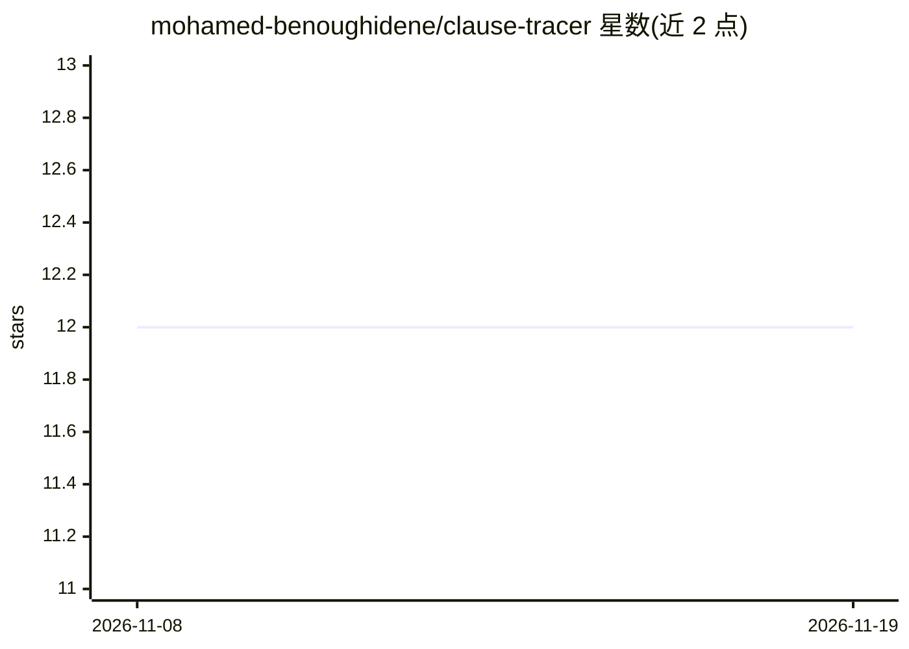

# mohamed-benoughidene/clause-tracer

⭐ 12 · HTML · NOASSERTION · 推送 2026-11-16 · [GitHub](https://github.com/mohamed-benoughidene/clause-tracer) · 个人维护

**本地优先的 AI 合同审查应用：自由职业者与小律所用自有 playbook 审查条款**

面向自由职业者、独立律师和小型律所的本地优先合同审查应用（Linux/Windows）。用户编写合同立场 playbook，应用读取合同并给每个条款打标，且每条标签链接到原文引用作为证据；数值与是非规则由代码而非 AI 判定，纯措辞判断的标签标记为 "AI judgment"。隐私方面用 Presidio 在本机替换个人数据（PII），数据静态加密、无遥测，LLM 通过 OpenRouter 自带密钥接入。状态为 in build，尚无可用应用功能，仅提供 HTML 原型与开发环境搭建说明。

## 筛选速览

| 维度 | 判定 | 备注 |
|---|---|---|
| AI 角色 | `ai-native` | 本体是模型或模型工具 |
| 许可风险 | `none` | NOASSERTION |
| 部署形态 | `library` | 以包/库形式分发 |
| 模型依赖 | locked-api |  |
| 硬件要求 | — | 无带数字的原话,不猜 |
| 安装摩擦 | `low` | 无编译、无系统依赖或容器化 |
| 成熟度 | `idea` | |

## 能力要点

- playbook 驱动的条款标签（Preferred/Acceptable/Walk-away/Unsure）并附原文引用证据
- Presidio 本机 PII 替换与静态加密，无遥测、无账号
- 数值/是非规则由代码复核 AI 抽取的值与引用，非纯模型判定
- 生成谈判回复邮件或 PDF 审查报告

## 适用场景

- 签客户合同或 NDA 前按自己的条款立场做第一轮审查
- 小律所不上传客户文件到云端的一致性初审
- 把 walk-away 条款整理成可发送的谈判邮件

## 场景标签

`文档解析` `AI 写作` · 领域:内容生成

## 证据(README 行号)

> L10: With **Clause Tracer**, you write a **playbook**, your rules for a good deal: "paid within 30 days", "liability cap
> L22: - **Code decides, not the AI.** For number and yes/no rules, the AI only pulls out the value and its quote. Code ch
> L70: |**AI**|Models on OpenRouter, using your own key (bring your own key). You pay OpenRouter directly, and the cost is

## 星数曲线

2026-11-08 12 → 2026-11-19 12（+0）

---
*卡片 v1 · prompt 1.4 · 生成 2026-11-18 · 置信度 high · 依据 README sha `3299ba4a0613` · [字段定义](../../DATASET.md)*
