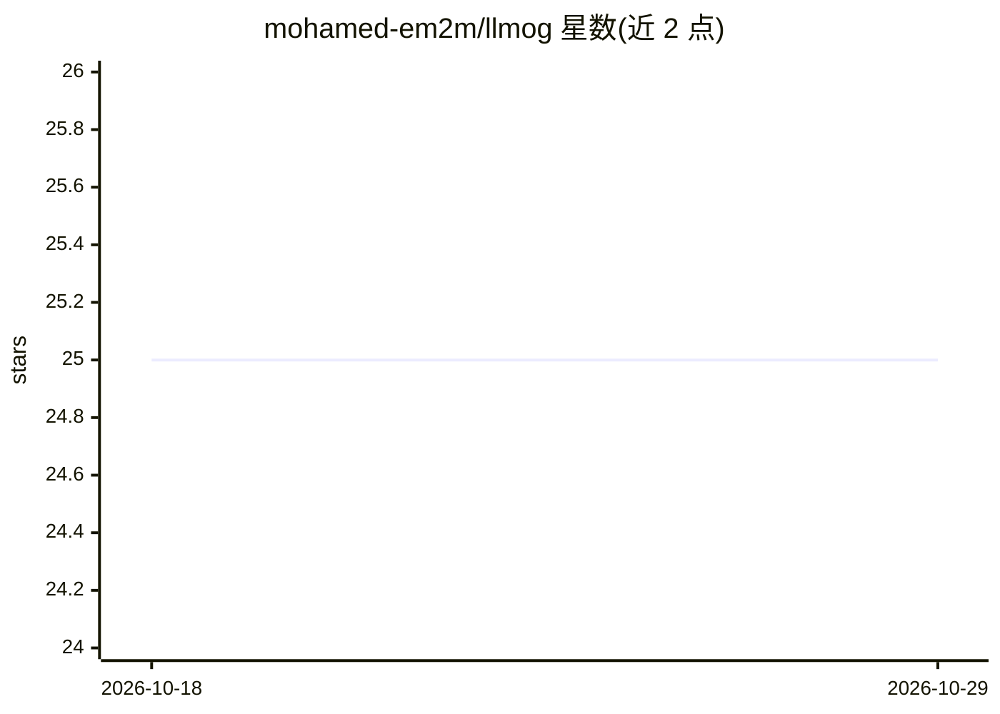

# mohamed-em2m/llmog

⭐ 25 · HTML · 推送 2026-10-04 · [GitHub](https://github.com/mohamed-em2m/llmog) · 个人维护

**用 VLM 做零训练目标检测与 YOLO 数据集重标注的库**

基于 Detector-Judge 迭代流水线的目标检测库：VLM 检测器提出边界框，VLM 评审器对照原图批评，循环自修正直至达到质量阈值或轮次上限。支持任意 OpenAI 兼容后端（llama.cpp、vLLM、Ollama、云端 API），内置 tiling、CLAHE、Set-of-Mark 提示、Crop-Verify 等小目标增强手段。auto_label 模式可遍历现有 YOLO 缺陷数据集做细粒度重分类并更新 data.yaml。提供统一 CLI、Gradio Web 界面与本地 llama-server/vLLM 生命周期管理器。需 Python 3.12+ 与 uv。

## 筛选速览

| 维度 | 判定 | 备注 |
|---|---|---|
| AI 角色 | `ai-native` | 本体是模型或模型工具 |
| 许可风险 | `none` | — |
| 部署形态 | `desktop` | 安装包/桌面程序 |
| 模型依赖 | local-ok | 支持本地模型 |
| 硬件要求 | — | 无带数字的原话,不猜 |
| 安装摩擦 | `medium` | 含编译或系统依赖之一 |
| 成熟度 | — | 结构信号不足 |

## 能力要点

- Detector-Judge 迭代流水线，按类别列表零训练检测
- auto_label 模式将二分类 YOLO 数据集重标注为多分类
- tiling、CLAHE、Set-of-Mark、Crop-Verify 等小目标预处理
- 内置 llama-server / llama-cpp-python / vLLM 服务器管理器与 Gradio Web 界面

## 适用场景

- 零训练检测自定义类别（如工业缺陷 crack/scratch/dent）
- 把粗粒度二分类缺陷数据集细化为多分类标签
- 在本地硬件上运行 VLM 检测，无需云端 API key

## 场景标签

`目标检测` `图像视频处理` · 领域:感知与多模态

## 证据(README 行号)

> L3: **A library for object detection tasks using LLMs.**
> L7: This project implements an iterative **Detector-Judge pipeline**: a VLM "detector" agent proposes bounding boxes, a 

## 星数曲线

2026-10-18 25 → 2026-10-29 25（+0）

---
*卡片 v1 · prompt 1.4 · 生成 2026-10-27 · 置信度 mid · 依据 README sha `7bbcdae4e6d7` · [字段定义](../../DATASET.md)*
