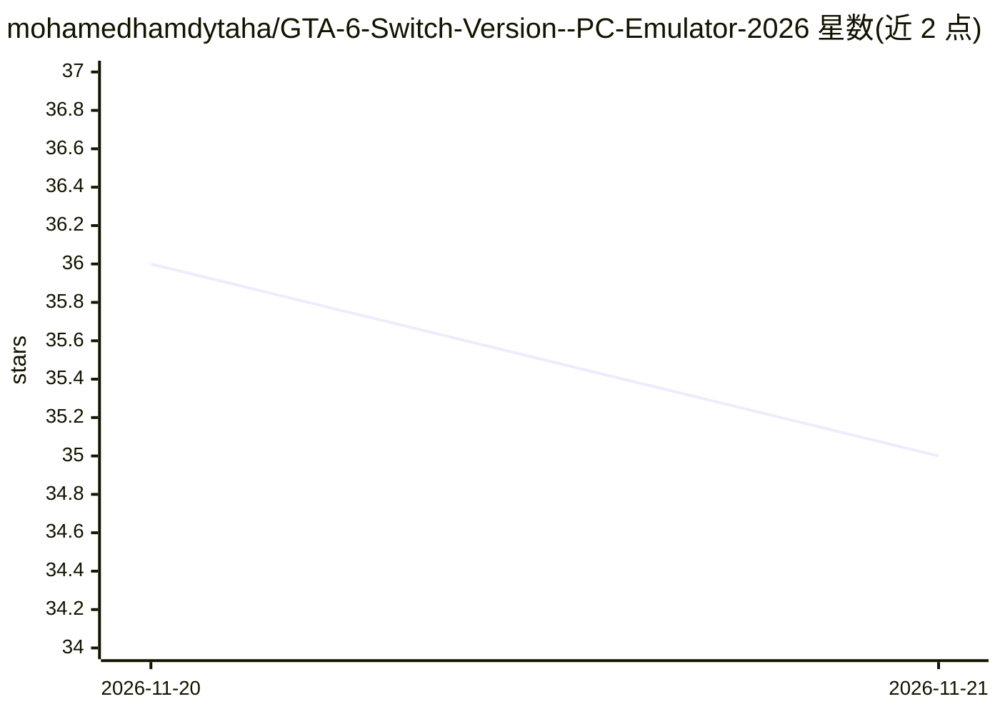

# mohamedhamdytaha/GTA-6-Switch-Version--PC-Emulator-2026

⭐ 35 · Go · Apache-2.0 · 推送 2026-11-19 · [GitHub](https://github.com/mohamedhamdytaha/GTA-6-Switch-Version--PC-Emulator-2026) · 个人维护

**面向 Windows 玩家的 GTA VI PC 版安装与配置指南站点**

该仓库提供一份面向 Windows 10/11 用户的 GTA VI PC 版准备资料，内容为通用 PC 游戏环境准备清单：Windows 更新、GPU 驱动检查、存储核查、Rockstar Games Launcher 准备与常见性能/安装问题排查。README 声明其安装包不含游戏文件，游戏需另行通过授权渠道获取；官方 PC 配置与发售日期均未公布，表中各项标记为未确认。README 末尾含 SEO 关键词段落，主题标签中的 ai/generative-ai 与正文内容无对应。

## 筛选速览

| 维度 | 判定 | 备注 |
|---|---|---|
| AI 角色 | `ai-knowledge` | 知识聚合/清单类 |
| 许可风险 | `permissive` | Apache-2.0 |
| 部署形态 | `desktop` | 安装包/桌面程序 |
| 模型依赖 | — | README 未给出锁定关系 |
| 硬件要求 | — | 无带数字的原话,不猜 |
| 安装摩擦 | `low` | 无编译、无系统依赖或容器化 |
| 成熟度 | `idea` | |

## 能力要点

- Windows 兼容性准备清单（系统版本、DirectX、驱动、存储检查）
- 通用 PC 图形设置与 FPS 排查指南（分辨率、阴影、V-Sync、帧生成等）
- 官方系统需求与发售日期未公布，各组件均标注 Not confirmed
- 自带安装包明确声明不含 GTA VI 游戏文件

## 适用场景

- 为未来 GTA VI PC 版提前准备 Windows 环境
- 排查 PC 游戏常见的低帧率、卡顿与显示问题
- 准备 Rockstar Games Launcher 与 GPU 驱动

## 场景标签

 · 领域:游戏/内容指南

## 证据(README 行号)

> L5: A dedicated PC installation and configuration resource for Grand Theft Auto VI, covering Windows preparation, graphi
> L49: The companion installer does not contain or install GTA VI game files.
> L266: ## 🔎 SEO Keywords

## 星数曲线

2026-11-20 36 → 2026-11-21 35（-1）

---
*卡片 v1 · prompt 1.4 · 生成 2026-11-20 · 置信度 low · 依据 README sha `6954d37a13d3` · [字段定义](../../DATASET.md)*
