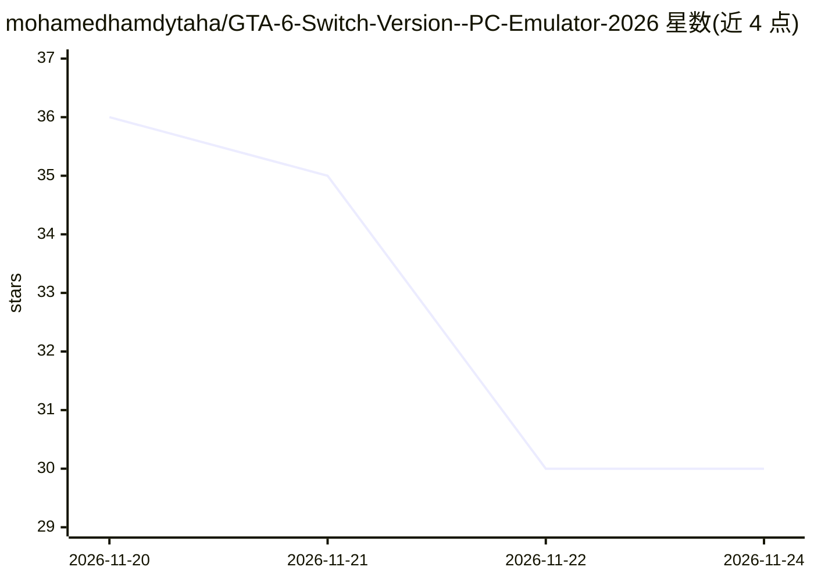

# mohamedhamdytaha/GTA-6-Switch-Version--PC-Emulator-2026

⭐ 30 · Rust · Apache-2.0 · 推送 2026-11-21 · [GitHub](https://github.com/mohamedhamdytaha/GTA-6-Switch-Version--PC-Emulator-2026) · 个人维护

**面向 Windows 玩家的 GTA VI PC 版安装准备与优化指南**

为等待 GTA VI PC 版发布的 Windows 用户提供准备性资料：系统环境检查（Windows 版本、DirectX、驱动、存储）、图形与 FPS 优化选项说明、安装故障排查类别、以及分步准备指南。README 明确说明其安装包不含 GTA VI 游戏文件，仅是一个独立的 Windows 设置伴随工具，官方 PC 版硬件要求与发布日期均未公布，相关表格标注为待更新。

## 筛选速览

| 维度 | 判定 | 备注 |
|---|---|---|
| AI 角色 | `ai-enhanced` | 去掉 AI 部分产品仍成立 |
| 许可风险 | `permissive` | Apache-2.0 |
| 部署形态 | `desktop` | 安装包/桌面程序 |
| 模型依赖 | — | README 未给出锁定关系 |
| 硬件要求 | — | 无带数字的原话,不猜 |
| 安装摩擦 | `low` | 无编译、无系统依赖或容器化 |
| 成熟度 | `idea` | |

## 能力要点

- 提供 Windows 兼容性准备清单（DirectX、驱动、存储、硬件信息）
- 覆盖图形设置、FPS 排障、帧时间一致性等常见 PC 游戏配置项
- 明确声明安装包不含或不安装 GTA VI 游戏文件

## 适用场景

- 在 GTA VI PC 版发布前提前检查并准备 Windows 环境
- 排查 PC 游戏常见安装错误与性能问题
- 了解通用图形设置选项的作用

## 场景标签

 · 领域:游戏/PC 工具

## 证据(README 行号)

> L17: This repository is dedicated to Windows users preparing for the future PC edition of GTA VI.
> L49: The companion installer does not contain or install GTA VI game files.
> L238: No. The project installer is intended for a separate Windows setup companion. GTA VI must be acquired through an a

## 星数曲线

2026-11-20 36 → 2026-11-24 30（-6）

---
*卡片 v1 · prompt 1.4 · 生成 2026-11-22 · 置信度 low · 依据 README sha `2fe487426686` · [字段定义](../../DATASET.md)*
