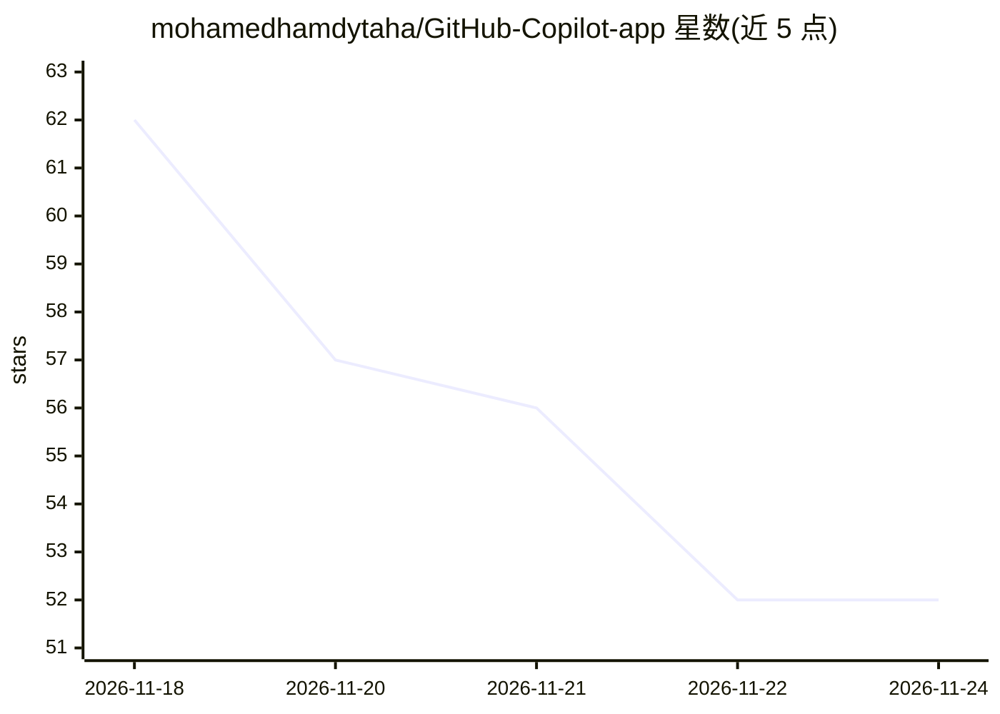

# mohamedhamdytaha/GitHub-Copilot-app

⭐ 52 · Apache-2.0 · 推送 2026-11-21 · [GitHub](https://github.com/mohamedhamdytaha/GitHub-Copilot-app) · 组织维护

**GitHub 官方桌面端：管理跨仓库的 agent 开发工作流**

GitHub 官方提供的桌面应用，作为从想法到 pull request 的单一控制中心：发现待办工作、启动并引导 agent 会话、查看进度、落地代码变更。本地会话运行在隔离的 git worktree 中，云会话在 GitHub 托管环境运行；Canvases 将 agent 的计划、终端、diff、工作流状态呈现为可查看可编辑的界面；另含 My Work 聚合视图、Automations 定时任务与 Agent Merge 合并流程。需要 Git 与任一 Copilot 订阅（含 Free/Student），无订阅时可自带模型密钥（BYOK）。

## 筛选速览

| 维度 | 判定 | 备注 |
|---|---|---|
| AI 角色 | `ai-ecosystem` | LLM/agent 周边工具 |
| 许可风险 | `permissive` | Apache-2.0 |
| 部署形态 | `desktop` | 安装包/桌面程序 |
| 模型依赖 | — | README 未给出锁定关系 |
| 硬件要求 | — | 无带数字的原话,不猜 |
| 安装摩擦 | `low` | 无编译、无系统依赖或容器化 |
| 成熟度 | — | 结构信号不足 |

## 能力要点

- 本地会话以隔离 git worktree 运行，云会话在 GitHub 托管环境并行工作
- Canvases 界面查看并编辑 agent 的计划、终端、diff 与工作流状态
- Automations 将可重复的 prompt 转为定时/后台任务，Agent Merge 处理审查与合并条件
- 无 Copilot 订阅时可 BYOK 自带模型密钥使用

## 适用场景

- 同时让多个 agent 处理修 bug、实现 issue、回应审查意见等任务
- 在一个界面管理跨仓库的 issue、PR 与 agent 会话
- 把重复性 prompt 配置为定时或后台自动化任务

## 场景标签

`编码 Agent` `工作流自动化` · 领域:效率与自动化

## 证据(README 行号)

> L3: The GitHub Copilot app is an agent-native desktop experience for finding, running, steering, and landing software wo
> L13: The GitHub Copilot app is an agent-native desktop experience for managing software work from idea to pull request. 
> L26: - A GitHub Copilot plan — any plan works, including Copilot Free and GitHub Copilot Student. No Copilot plan? You c

## 星数曲线

2026-11-18 62 → 2026-11-24 52（-10）

---
*卡片 v1 · prompt 1.4 · 生成 2026-11-19 · 置信度 high · 依据 README sha `db7fa9f8df45` · [字段定义](../../DATASET.md)*
