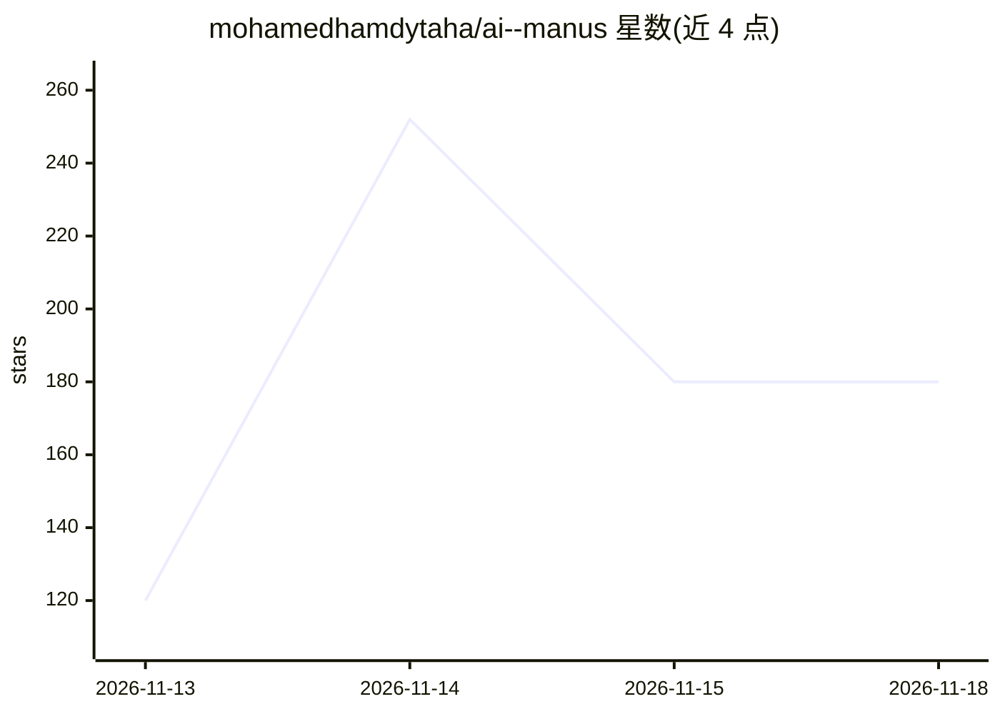

# mohamedhamdytaha/ai--manus

⭐ 180 · Apache-2.0 · 推送 2026-11-17 · [GitHub](https://github.com/mohamedhamdytaha/ai--manus) · 个人维护

**自主 AI Agent：代用户执行代码并控制浏览器完成多步任务**

面向个人用户（学生、远程工作者）的自主 AI agent 应用：按用户指令自主编写并执行脚本、打开网页、操作页面元素、执行多步任务，代码执行与浏览器控制可在同一流程内衔接。定位为家庭、学习与轻量工作场景的小型助手，不面向企业级平台场景。README 提供兼容性表（最低 4 GB 内存、双核 CPU）与使用步骤说明，但未给出具体安装命令、下载渠道或模型接入方式。

## 筛选速览

| 维度 | 判定 | 备注 |
|---|---|---|
| AI 角色 | `ai-native` | 本体是模型或模型工具 |
| 许可风险 | `permissive` | Apache-2.0 |
| 部署形态 | `None` |  |
| 模型依赖 | — | README 未给出锁定关系 |
| 硬件要求 | — | 无带数字的原话,不猜 |
| 安装摩擦 | `low` | 无编译、无系统依赖或容器化 |
| 成熟度 | — | 结构信号不足 |

## 能力要点

- 自主编写并执行代码完成任务
- 浏览器控制：导航网页、填表、收集信息
- 代码执行与浏览器操作在同一工作流中衔接
- 跨会话保持任务模式，支持后台常驻

## 适用场景

- 让学生整理研究资料、运行小脚本
- 远程工作者从多个网页收集数据并汇总
- 把脚本任务与网页操作衔接的日常小项目自动化

## 场景标签

`浏览器自动化` `编码 Agent` `AI 助手` · 领域:效率与自动化

## 证据(README 行号)

> L10: - **Autonomous Code Execution:** Manus AI agent runs code on its own to complete tasks, so you can focus on decisio
> L18: Manus is an autonomous AI agent designed to run code and control a browser on your behalf. Instead of acting like a

## 星数曲线

2026-11-13 120 → 2026-11-18 180（+60）

---
*卡片 v1 · prompt 1.4 · 生成 2026-11-18 · 置信度 mid · 依据 README sha `0eccc6fbe733` · [字段定义](../../DATASET.md)*
