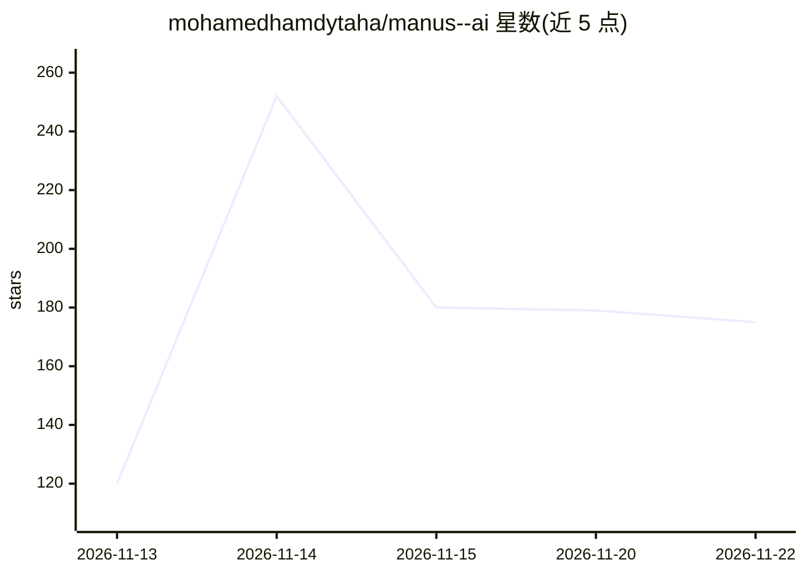

# mohamedhamdytaha/manus--ai

⭐ 175 · Apache-2.0 · 推送 2026-11-21 · [GitHub](https://github.com/mohamedhamdytaha/manus--ai) · 个人维护

**面向个人用户的自主 AI Agent，可代为执行代码与浏览器操作**

README 将 Manus 描述为一个自主 AI Agent：用户描述任务后，由代理自行编写并执行脚本、控制浏览器（导航网页、填写表单、收集信息），完成多步骤任务并跨会话保持行为一致。定位为面向家庭、学习和轻量办公场景的个人助手，非企业平台，目标用户不要求具备开发背景。README 未给出具体安装命令、技术栈或代码仓库结构，仅提供下载入口与最低硬件配置表（64 位系统、4 GB 内存）。

## 筛选速览

| 维度 | 判定 | 备注 |
|---|---|---|
| AI 角色 | `ai-native` | 本体是模型或模型工具 |
| 许可风险 | `permissive` | Apache-2.0 |
| 部署形态 | `None` |  |
| 模型依赖 | — | README 未给出锁定关系 |
| 硬件要求 | — | 无带数字的原话,不猜 |
| 安装摩擦 | `low` | 无编译、无系统依赖或容器化 |
| 成熟度 | — | 结构信号不足 |

## 能力要点

- 自主执行代码以完成任务
- 代理控制浏览器：导航网页、填写表单、收集信息
- 多步骤自主任务，跨会话保持一致行为
- 提供最低硬件配置表（4 GB 内存起步）

## 适用场景

- 让代理代我整理研究资料、跑小脚本
- 自动填表和从多个网页收集信息
- 把日常重复的小任务交给代理处理

## 场景标签

`AI 助手` `浏览器自动化` · 领域:效率与自动化

## 证据(README 行号)

> L18: Manus is an autonomous AI agent designed to run code and control a browser on your behalf. Instead of acting like a
> L22: Manus is not a heavy studio suite or a complex enterprise platform. It is a focused helper built for home, study, a
> L40: |**Processor (CPU)**|Dual-core CPU|Modern multi-core CPU for smooth Manus code automation|

## 星数曲线

2026-11-13 120 → 2026-11-22 175（+55）

---
*卡片 v1 · prompt 1.4 · 生成 2026-11-20 · 置信度 mid · 依据 README sha `4c4e3d0385a9` · [字段定义](../../DATASET.md)*
