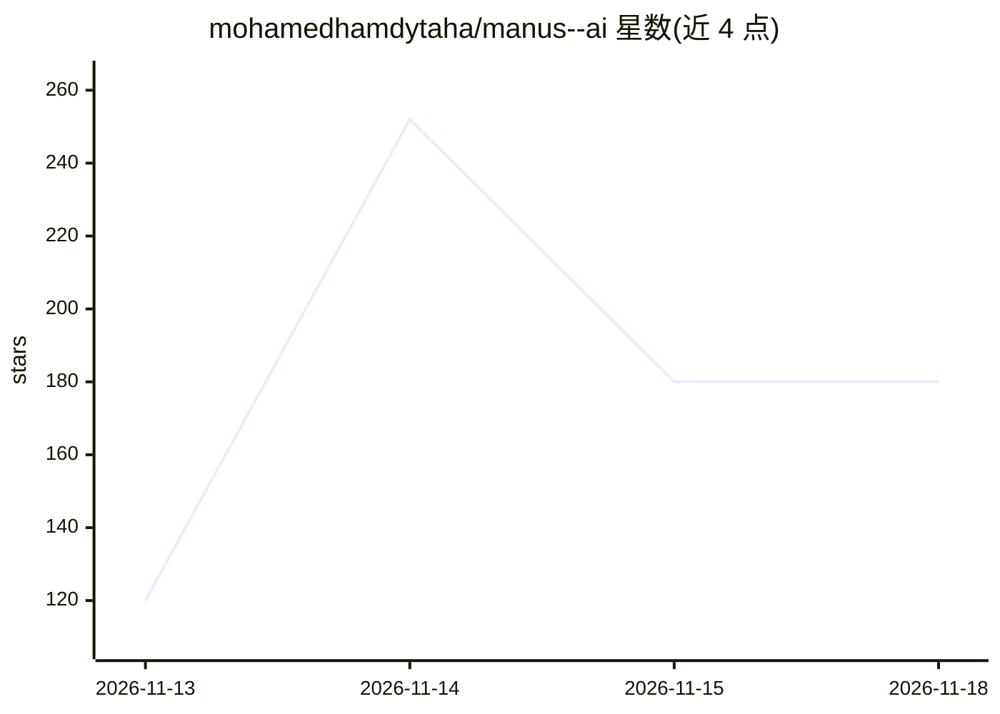

# mohamedhamdytaha/manus--ai

⭐ 180 · Apache-2.0 · 推送 2026-11-17 · [GitHub](https://github.com/mohamedhamdytaha/manus--ai) · 个人维护

**面向日常任务的自主 AI 代理：自行写代码并操控浏览器**

README 介绍的 Manus 是一款自主 AI 代理，按用户指令自行编写并执行脚本、控制浏览器完成表单填写与信息收集等多步骤任务，面向学习、家庭项目与轻量办公场景。代码执行与浏览器操作可在同一工作流中衔接，支持跨会话记忆工作模式。README 声明最低配置为 64 位系统、双核 CPU 与 4 GB 内存；给出配置、测试与维护步骤，但未提供具体安装命令、代码入口或技术实现细节。

## 筛选速览

| 维度 | 判定 | 备注 |
|---|---|---|
| AI 角色 | `ai-native` | 本体是模型或模型工具 |
| 许可风险 | `permissive` | Apache-2.0 |
| 部署形态 | `None` |  |
| 模型依赖 | — | README 未给出锁定关系 |
| 硬件要求 | — | 无带数字的原话,不猜 |
| 安装摩擦 | `low` | 无编译、无系统依赖或容器化 |
| 成熟度 | — | 结构信号不足 |

## 能力要点

- 自主编写并执行脚本完成任务
- 代理控制浏览器进行导航、填表与信息收集
- 代码与浏览器操作在同一工作流中衔接

## 适用场景

- 让学生整理研究笔记并运行小型计算脚本
- 让代理代替人工浏览多页面收集数据并汇总
- 自动处理日常重复性小任务

## 场景标签

`编码 Agent` `浏览器自动化` · 领域:效率与自动化

## 证据(README 行号)

> L10: - **Autonomous Code Execution:** Manus AI agent runs code on its own to complete tasks, so you can focus on decisio
> L18: Manus is an autonomous AI agent designed to run code and control a browser on your behalf. Instead of acting like a
> L22: Manus is not a heavy studio suite or a complex enterprise platform. It is a focused helper built for home, study, a

## 星数曲线

2026-11-13 120 → 2026-11-18 180（+60）

---
*卡片 v1 · prompt 1.4 · 生成 2026-11-18 · 置信度 mid · 依据 README sha `0eccc6fbe733` · [字段定义](../../DATASET.md)*
