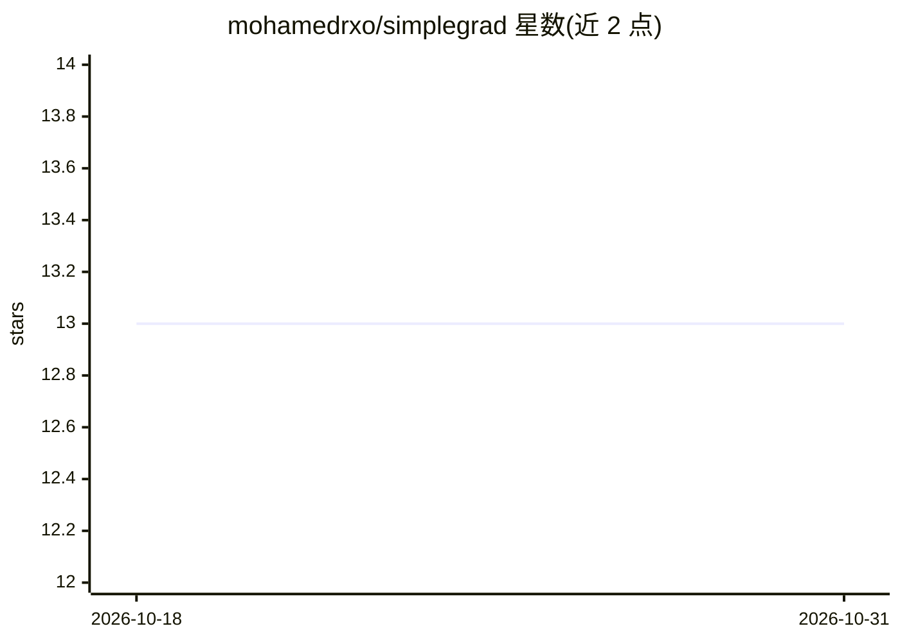

# mohamedrxo/simplegrad

⭐ 13 · Jupyter Notebook · MIT · 推送 2026-08-12 · [GitHub](https://github.com/mohamedrxo/simplegrad) · [官网](https://pypi.org/project/simplegrade) · 个人维护

**基于 NumPy 的教学型自动微分与神经网络框架**

SimpleGrade 是受 PyTorch 和 Tinygrad 启发的轻量级 Python 库，基于 NumPy 实现自动微分（autograd）和构建、训练神经网络所需的核心组件，定位为帮助理解深度学习库内部工作原理的教育性框架。提供 Tensor 运算、Linear 层、损失函数、SGD 优化器和 DataLoader 等构件，README 附带基础张量示例和 MNIST 训练完整示例（依赖 pandas 与 kagglehub 取数）。通过 PyPI 的 pip install simplegrade 安装，或从 GitHub 克隆源码以可编辑模式安装。MIT 许可。

## 筛选速览

| 维度 | 判定 | 备注 |
|---|---|---|
| AI 角色 | `ai-ecosystem` | LLM/agent 周边工具 |
| 许可风险 | `permissive` | MIT |
| 部署形态 | `library` | 以包/库形式分发 |
| 模型依赖 | — | README 未给出锁定关系 |
| 硬件要求 | — | 无带数字的原话,不猜 |
| 安装摩擦 | `low` | 无编译、无系统依赖或容器化 |
| 成熟度 | — | 结构信号不足 |

## 能力要点

- 基于 NumPy 的自动微分实现
- 提供 Linear 层、损失函数、SGD 优化器与 DataLoader 等神经网络构件
- 附 MNIST 训练完整示例

## 适用场景

- 学习自动微分与深度学习库的内部原理
- 从零构建并训练小型神经网络

## 场景标签

`教程课程` · 领域:学习与行业

## 证据(README 行号)

> L8: SimpleGrade is a lightweight Python library inspired by PyTorch and Tinygrad. It provides automatic differentiation 
> L28: - Automatic differentiation (Autograd)

## 星数曲线

2026-10-18 13 → 2026-10-31 13（+0）

---
*卡片 v1 · prompt 1.4 · 生成 2026-10-31 · 置信度 high · 依据 README sha `22798fd70384` · [字段定义](../../DATASET.md)*
