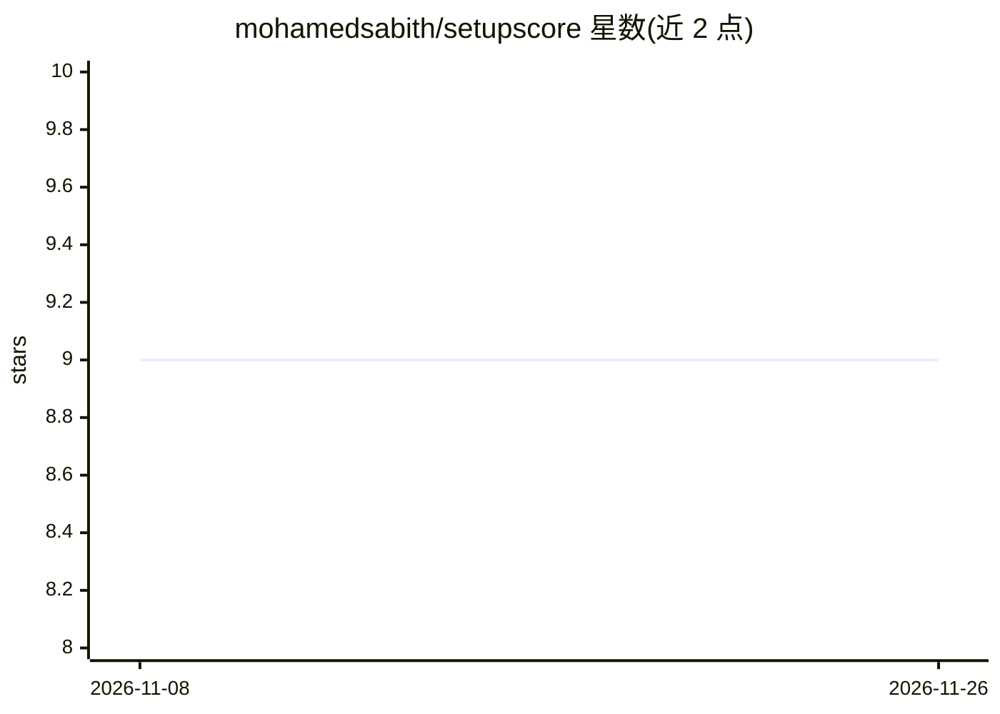

# mohamedsabith/setupscore

⭐ 9 · TypeScript · MIT · 推送 2026-11-23 · [GitHub](https://github.com/mohamedsabith/setupscore) · 个人维护

**为 Claude Code 配置文件做体检与基准评测的 CLI 工具**

面向使用 Claude Code 的项目，检查 CLAUDE.md、.claude/ 目录与 .mcp.json 等 setup 文件中的失效路径、缺失脚本、矛盾或模糊规则、泄露密钥与 MCP 问题，并输出英文修复建议与 0-10 的 instruction health 分数。可选的 run 功能从 git 历史取真实提交作为任务，在有/无 setup 两种条件下运行 Claude Code，用提交自带的隐藏测试评分并给出 0-100 的 Setup Score 与统计显著性。check 免费离线、不调用 AI；run 需 API key 或订阅 token，默认花费上限 $5。

## 筛选速览

| 维度 | 判定 | 备注 |
|---|---|---|
| AI 角色 | `ai-ecosystem` | LLM/agent 周边工具 |
| 许可风险 | `permissive` | MIT |
| 部署形态 | `library` | 以包/库形式分发 |
| 模型依赖 | locked-api |  |
| 硬件要求 | — | 无带数字的原话,不猜 |
| 安装摩擦 | `low` | 无编译、无系统依赖或容器化 |
| 成熟度 | — | 结构信号不足 |

## 能力要点

- check 模式离线运行、零 AI 调用，一秒内列出错误与警告及修复建议
- run 模式用真实提交与隐藏测试对 setup 做 A/B 基准评分（0-100）
- 提供 --fix 自动修复路径、--cost 显示每个文件的会话开销
- 支持 GitHub Actions 在 PR 中自动检查并回帖评分

## 适用场景

- 检查 CLAUDE.md 是否还与代码库实际结构一致
- 团队合并前拦截 setup 文件错误与泄露的密钥
- 量化验证新版 CLAUDE.md 是否真的让 Claude 表现更好
- 在 CI 中对改动 setup 的 PR 做失败检查

## 场景标签

`提示工程` `模型评测` · 领域:Agent 开发

## 证据(README 行号)

> L18: **setupscore checks the instructions you give Claude Code, and tells you in plain English what is broken and how to
> L74: `npx setupscore` reads your setup files and lists every problem. It is **free, works offline, and makes no AI calls
> L104: 1. It takes real changes from your project's git history: commits that changed both code and tests.

## 星数曲线

2026-11-08 9 → 2026-11-26 9（+0）

---
*卡片 v1 · prompt 1.4 · 生成 2026-11-20 · 置信度 high · 依据 README sha `9b6c812f171f` · [字段定义](../../DATASET.md)*
