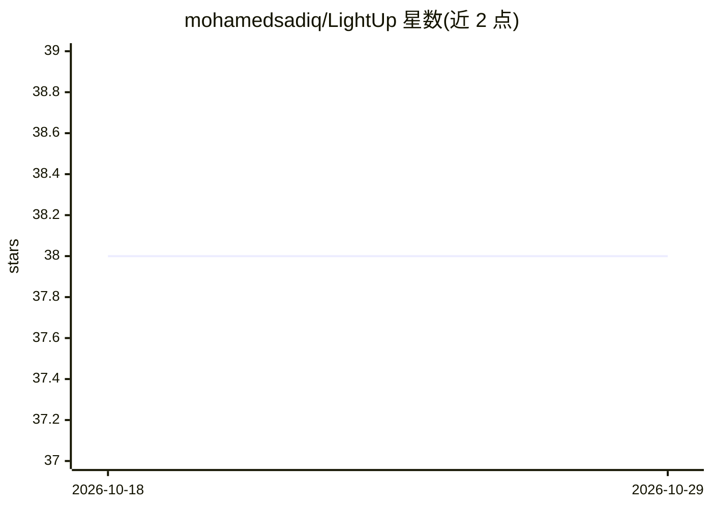

# mohamedsadiq/LightUp

⭐ 38 · TypeScript · Apache-2.0 · 推送 2026-02-06 · [GitHub](https://github.com/mohamedsadiq/LightUp) · [官网](https://www.boimaginations.com/lightup) · 个人维护

**网页划词即得 AI 解释/翻译/总结的 Chrome 扩展**

Chrome 浏览器扩展：选中文本后在页面内以浮动、侧栏或居中弹窗获得解释、总结、分析、翻译与自由问答，支持追问、快捷键与自定义提示词。AI 后端可切换 OpenAI、Gemini、xAI/Grok，也可接本地 LLM（Ollama、LM Studio、Text Generation WebUI 等暴露 /v1/chat/completions 的服务），本地模式内容不出设备；会话仅存内存，API key 加密存储。用户可从 Chrome Web Store、GitHub Releases 或手动加载 ZIP 安装，开发者用 pnpm 构建。

## 筛选速览

| 维度 | 判定 | 备注 |
|---|---|---|
| AI 角色 | `ai-native` | 本体是模型或模型工具 |
| 许可风险 | `permissive` | Apache-2.0 |
| 部署形态 | `library` | 以包/库形式分发 |
| 模型依赖 | local-ok | 支持本地模型 |
| 硬件要求 | — | 无带数字的原话,不猜 |
| 安装摩擦 | `low` | 无编译、无系统依赖或容器化 |
| 成熟度 | — | 结构信号不足 |

## 能力要点

- 选中文本即在页面内解释/总结/分析/翻译/自由问答
- 多后端：OpenAI、Gemini、xAI/Grok 及本地 LLM（Ollama 等）
- 会话仅存内存、API key 加密、本地处理可选
- 三种 UI 布局与键盘快捷键

## 适用场景

- 阅读网页时划词获取解释或翻译，不切换标签页
- 通过本地 LLM 做隐私敏感文本的分析
- 自定义提示词构建个人工作流动作

## 场景标签

`AI 助手` · 领域:对话与助手

## 证据(README 行号)

> L11: **LightUp lets you highlight any text and get instant AI explanations, summaries, translations, and more—right on t
> L57: - **Local LLM**: Ollama, LM Studio, Text Generation WebUI via `http://127.0.0.1:1234` or custom URL

## 星数曲线

2026-10-18 38 → 2026-10-29 38（+0）

---
*卡片 v1 · prompt 1.4 · 生成 2026-10-25 · 置信度 mid · 依据 README sha `d9d0dda235be` · [字段定义](../../DATASET.md)*
