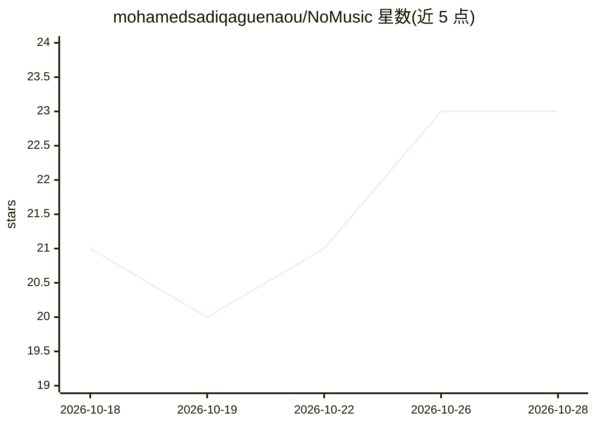

# mohamedsadiqaguenaou/NoMusic

⭐ 23 · Rust · ISC · 推送 2026-10-18 · [GitHub](https://github.com/mohamedsadiqaguenaou/NoMusic) · [官网](https://chromewebstore.google.com/detail/fepfnjijcojaoihcekfhonohejglmdbc?utm_source=github.com) · 个人维护

**实时移除网页视频背景音乐的浏览器扩展，全本地处理**

面向观看在线视频内容的用户的浏览器扩展：捕获当前标签页音频，在浏览器内运行预先编译为独立 WebAssembly 的 FastEnhancer 语音增强模型（提供 Standard 与 Lite 两档），再经逐声道 RNNoise 去噪级联处理，实时播放处理后的音频。基于 Manifest V3 service worker 与 offscreen document 架构，音频经共享缓冲在 worker 与 AudioWorklet 间传递。全部处理在本地进行，仓库不含服务端组件或云端上传路径。通过 Chrome Web Store、Edge Add-ons 安装，或开发者模式加载源码。

## 筛选速览

| 维度 | 判定 | 备注 |
|---|---|---|
| AI 角色 | `ai-native` | 本体是模型或模型工具 |
| 许可风险 | `permissive` | ISC |
| 部署形态 | `None` |  |
| 模型依赖 | — | README 未给出锁定关系 |
| 硬件要求 | — | 无带数字的原话,不猜 |
| 安装摩擦 | `low` | 无编译、无系统依赖或容器化 |
| 成熟度 | — | 结构信号不足 |

## 能力要点

- FastEnhancer 编译为独立 WASM 模块（不依赖 ONNX Runtime）在浏览器内实时增强
- Standard/Lite 两档模型权衡算力与音质
- FastEnhancer 后接逐声道 RNNoise 二次降噪
- 全本地处理，无后端服务与云端上传路径

## 适用场景

- 观看在线视频时去掉背景音乐只听人声
- 在不想安装桌面软件的情况下做浏览器内实时语音增强
- 注重隐私、要求音频不上传云端的实时降噪

## 场景标签

 · 领域:音频处理/浏览器工具

## 证据(README 行号)

> L16: - Captures the active tab audio stream.
> L17: - Runs speech enhancement in the browser with FastEnhancer compiled ahead of time into a standalone WebAssembly mod
> L19: - Runs an RNNoise denoising stage after FastEnhancer enhancement for additional noise suppression.

## 星数曲线

2026-10-18 21 → 2026-10-28 23（+2）

---
*卡片 v1 · prompt 1.4 · 生成 2026-10-27 · 置信度 high · 依据 README sha `7b96cd8c1027` · [字段定义](../../DATASET.md)*
