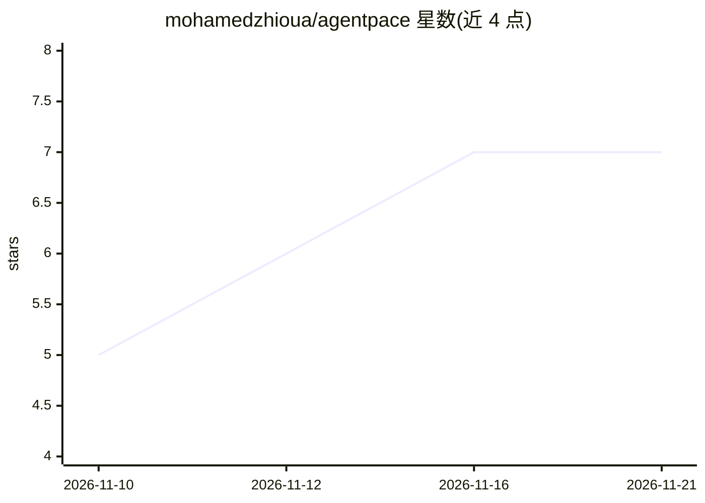

# mohamedzhioua/agentpace

⭐ 7 · Python · MIT · 推送 2026-11-10 · [GitHub](https://github.com/mohamedzhioua/agentpace) · [官网](https://mohamedzhioua.github.io/agentpace/) · 个人维护

**为开发者度量编码 agent 实际耗时的 CLI 与数据集**

agentpace 基于 3,383 条真实 Claude Code 子代理运行与 Codex 回合记录，对 agent 工作计划输出 P50/P80/P90 耗时区间；人的部分（评审、测试、决策）单列一行且不从 agent 时间推导。提供零依赖标准库 Python CLI、agent skill 与 CC0 数据集，可从本地会话历史采集数据、回测校准并对照被引用的时间估算。记录自己的运行目前仅支持 Claude Code 子代理，Codex 为实验外其他工具适配为实验性。

## 筛选速览

| 维度 | 判定 | 备注 |
|---|---|---|
| AI 角色 | `ai-ecosystem` | LLM/agent 周边工具 |
| 许可风险 | `permissive` | MIT |
| 部署形态 | `library` | 以包/库形式分发 |
| 模型依赖 | locked-api |  |
| 硬件要求 | — | 无带数字的原话,不猜 |
| 安装摩擦 | `low` | 无编译、无系统依赖或容器化 |
| 成熟度 | — | 结构信号不足 |

## 能力要点

- 基于真实 agent 运行数据输出 P50/P80/P90 耗时区间
- 人的时间单列陈述，从不由 agent 时间推导
- 标准库 Python CLI，零依赖，数据集为 CC0 许可
- 提供 backtest/score/validate 命令，公开预测命中率

## 适用场景

- 在开工前估算一个功能交给编码 agent 需要多久
- 把别人口头的『3 个月项目』拆成 agent 任务并给出测量区间
- 记录并贡献自己的 Claude Code/Codex 运行数据
- 用回测检验自己历史预测的准确度

## 场景标签

 · 领域:开发工具/项目估算

## 证据(README 行号)

> L65: Ask an assistant how long a feature will take and it answers in human-team time, "a few weeks", even when agents wi
> L76: |Log your own runs|Claude Code, subagent runs only: work Claude Code hands to a subagent, not the main conversation
> L77: |Log your own Codex runs|Codex, one agent turn per run: `agentpace ingest --source codex` reads `~/.codex/sessions`

## 星数曲线

2026-11-10 5 → 2026-11-21 7（+2）

---
*卡片 v1 · prompt 1.4 · 生成 2026-11-20 · 置信度 high · 依据 README sha `9e7e76e2f4e3` · [字段定义](../../DATASET.md)*
