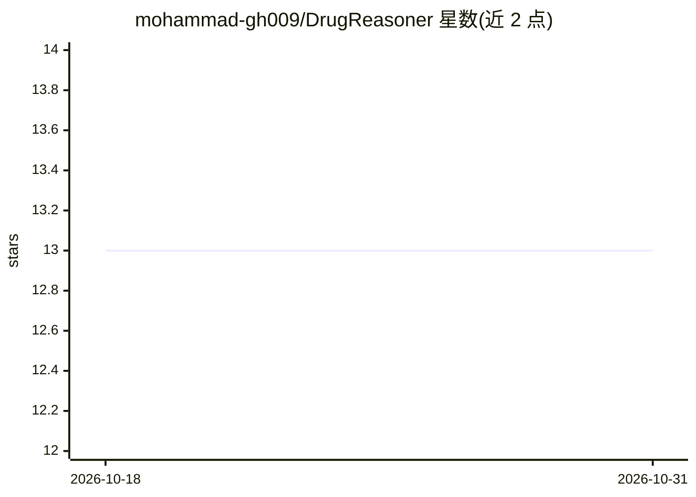

# mohammad-gh009/DrugReasoner

⭐ 13 · Python · Apache-2.0 · 推送 2026-07-02 · [GitHub](https://github.com/mohammad-gh009/DrugReasoner) · [官网](https://huggingface.co/Moreza009/Llama-DrugReasoner) · 组织维护

**面向药物研发者的可解释药物审批预测系统（推理增强 LLM）**

DrugReasoner 是一个药物审批结果预测系统：使用微调的 Llama-3.1-8B-Instruct 模型（HuggingFace 上的 Llama-DrugReasoner），结合 SMILES 分子结构分析进行审批预测，并输出预测背后的推理过程与相似已批准/未批准化合物作为参照。支持单分子与批量推理，提供 CLI 与 Python API 两种用法。需先向 HuggingFace 申请 Llama 基座模型访问权限，推理需 GPU（无 GPU 时可用作者提供的 Kaggle Notebook）。模型与数据集托管在 HuggingFace，配 arXiv 论文。

## 筛选速览

| 维度 | 判定 | 备注 |
|---|---|---|
| AI 角色 | `ai-native` | 本体是模型或模型工具 |
| 许可风险 | `permissive` | Apache-2.0 |
| 部署形态 | `library` | 以包/库形式分发 |
| 模型依赖 | — | README 未给出锁定关系 |
| 硬件要求 | — | 无带数字的原话,不猜 |
| 安装摩擦 | `medium` | 含编译或系统依赖之一 |
| 成熟度 | — | 结构信号不足 |

## 能力要点

- 基于微调 Llama 模型的药物审批预测
- SMILES 分子结构分析
- 预测附带可解释推理与相似化合物上下文
- CLI 与 Python API，支持单分子与批量推理

## 适用场景

- 药物研发中预判候选药物的审批结果
- 查看审批预测背后的推理依据辅助决策
- 批量筛选分子并输出审批预测结果

## 场景标签

 · 领域:药物发现/生物医学AI

## 证据(README 行号)

> L21: **DrugReasoner** is an AI-powered system for predicting drug approval outcomes using reasoning-augmented Large Lang
> L27: - **🤖 LLM-Powered Predictions**: Utilizes fine-tuned Llama model for drug approval prediction

## 星数曲线

2026-10-18 13 → 2026-10-31 13（+0）

---
*卡片 v1 · prompt 1.4 · 生成 2026-10-31 · 置信度 mid · 依据 README sha `f1eb4d1b2f6e` · [字段定义](../../DATASET.md)*
