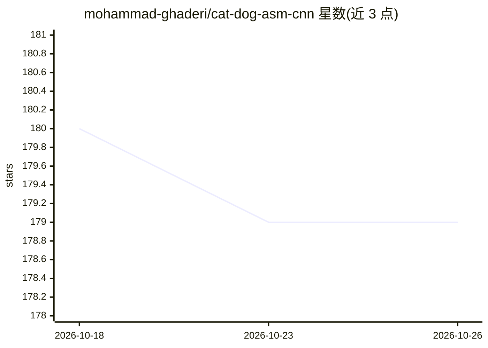

# mohammad-ghaderi/cat-dog-asm-cnn

⭐ 179 · Assembly · MIT · 推送 2026-02-08 · [GitHub](https://github.com/mohammad-ghaderi/cat-dog-asm-cnn) · 个人维护

**纯 x86-64 汇编 + AVX-512 实现的猫狗图像分类 CNN**

用纯 x86-64 汇编（NASM）从零实现的卷积神经网络，完成猫狗图像分类，不依赖任何机器学习框架或库。覆盖 Conv2D、MaxPool、Dense 层、前向与反向传播、数据加载器，超参数可配置。使用 AVX-512 指令并行处理 16 个 float32，README 声称比等效 NumPy 实现快约 10 倍（训练与推理），但未达 PyTorch 性能。数据集为 25,000 张 128×128×3 RGB 图像，准确率与 Python 版本相同（78%）。运行环境为 Debian Slim + Docker，通过 build.sh 汇编链接生成可执行文件。

## 筛选速览

| 维度 | 判定 | 备注 |
|---|---|---|
| AI 角色 | `ai-native` | 本体是模型或模型工具 |
| 许可风险 | `permissive` | MIT |
| 部署形态 | `self-host` | docker 或自建部署 |
| 模型依赖 | — | README 未给出锁定关系 |
| 硬件要求 | — | 无带数字的原话,不猜 |
| 安装摩擦 | `low` | 无编译、无系统依赖或容器化 |
| 成熟度 | — | 结构信号不足 |

## 能力要点

- 纯汇编实现 Conv2D/MaxPool/Dense/前向与反向传播，无 ML 框架依赖
- AVX-512 SIMD 向量化，ZMM 寄存器一次处理 16 个 float32
- 超参数驱动、层可配置的通用化设计
- 提供 Docker 构建与运行流程及 build.sh 脚本

## 适用场景

- 研究 CNN 在指令级别的内存布局与数据移动
- 学习无库条件下卷积与反向传播的底层实现
- 对比汇编 SIMD 与 NumPy 实现的训练/推理性能

## 场景标签

 · 领域:机器学习/系统编程

## 证据(README 行号)

> L9: This project implements a full Convolutional Neural Network (CNN) entirely in x86-64 **assembly language** for **cat
> L11: The goal of this project was to gain a deep, low-level understanding of CNNs, focusing on memory layout, data movem

## 星数曲线

2026-10-18 180 → 2026-10-26 179（-1）

---
*卡片 v1 · prompt 1.4 · 生成 2026-10-22 · 置信度 high · 依据 README sha `34587058a28c` · [字段定义](../../DATASET.md)*
