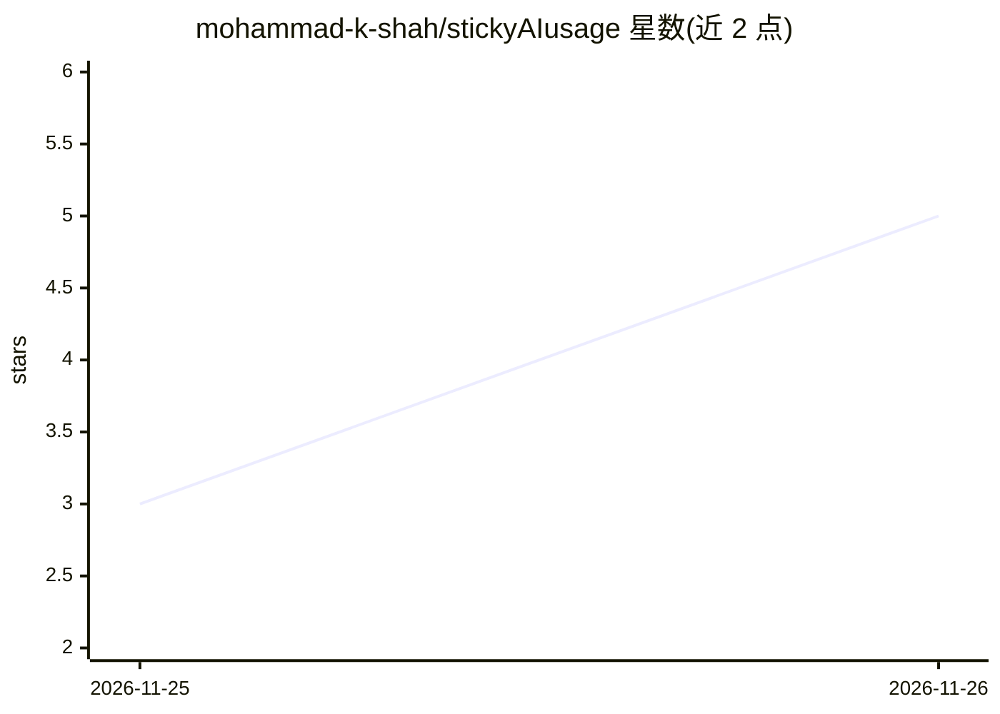

# mohammad-k-shah/stickyAIusage

⭐ — · [GitHub]() · 个人维护 · 中文 README

**在系统栏实时显示 Claude Code 用量与限额的工具**

常驻 Windows 任务栏或 macOS 菜单栏的用量监视组件：读取 Claude Code 通过配套插件在本地生成的用量数据，显示 5 小时/周窗口或月度消费上限、按当前速率推算触达限额的时间、各会话等待/运行/完成状态，并发出一次性通知。默认不读登录凭据、不联网；可选 Automatic/Legacy 模式读取 Anthropic 用量服务。另支持 Codex 用量卡片、费用估算、分享图片生成。基于 Avalonia（.NET），提供一键安装脚本与 Claude Code 插件两种接入方式。

## 筛选速览

| 维度 | 判定 | 备注 |
|---|---|---|
| AI 角色 | `ai-ecosystem` | LLM/agent 周边工具 |
| 许可风险 | `permissive` | — |
| 部署形态 | `desktop` | 安装包/桌面程序 |
| 模型依赖 | — | README 未给出锁定关系 |
| 硬件要求 | — | 无带数字的原话,不猜 |
| 安装摩擦 | `medium` | 含编译或系统依赖之一 |
| 成熟度 | — | 结构信号不足 |

## 能力要点

- 任务栏/菜单栏常驻显示 5 小时与周窗口用量及限额预计时间
- 配套插件经 Claude Code 官方接口获取数据，默认无网络请求
- 会话状态圆点：等待/运行/完成/触发限流，最多四个
- 读取本地 Codex 会话日志显示 Codex 用量卡片

## 适用场景

- 在触达 Claude Code 用量限额前收到提醒，避免会话被阻断
- 同时管理多个并行 Claude Code 会话时查看哪个在等待授权
- 跟踪每月消费上限与单会话成本
- 在限额临近时决定子代理是否降级到 Haiku 或跳过

## 场景标签

 · 领域:开发者工具/AI 用量监控

## 证据(README 行号)

> L6: Your Claude Code limits in the Windows taskbar or the Mac menu bar, the time you'll hit them at this pace, and which
> L74:   A["Claude Code (terminal, Desktop Code tab, VS Code)"] -->|"its own figures, after each answer"| B["the plugi
> L104: |🔌 **Straight from Claude Code**|With the companion plugin, Claude Code itself hands over your limits after every 

## 星数曲线

2026-11-25 3 → 2026-11-26 5（+2）

---
*卡片 v1 · prompt 1.4 · 生成 2026-11-24 · 置信度 high · 依据 README sha `e61b5d21ed51` · [字段定义](../../DATASET.md)*
