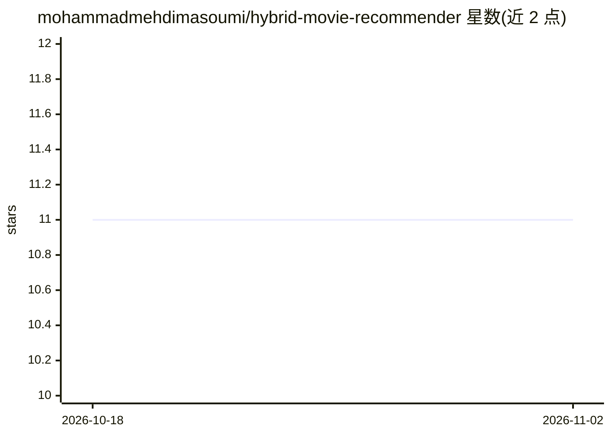

# mohammadmehdimasoumi/hybrid-movie-recommender

⭐ 11 · Python · MIT · 推送 2026-06-10 · [GitHub](https://github.com/mohammadmehdimasoumi/hybrid-movie-recommender) · 个人维护

**混合算法电影推荐系统：协同过滤+内容过滤生成个性化推荐**

基于 Python、Pandas、NumPy、Scikit-learn 实现的电影推荐系统，结合基于用户的协同过滤（Pearson 相关）与基于 TF-IDF 的内容过滤，以加权评分的混合方式生成个性化电影推荐，并支持实时推荐输出。提供 Streamlit 网页应用作为交互界面，覆盖从预处理、建模到 UI 的端到端 ML 流程。通过 git clone 源码加 pip 安装依赖、streamlit run 命令运行。

## 筛选速览

| 维度 | 判定 | 备注 |
|---|---|---|
| AI 角色 | `ai-native` | 本体是模型或模型工具 |
| 许可风险 | `permissive` | MIT |
| 部署形态 | `library` | 以包/库形式分发 |
| 模型依赖 | — | README 未给出锁定关系 |
| 硬件要求 | — | 无带数字的原话,不猜 |
| 安装摩擦 | `low` | 无编译、无系统依赖或容器化 |
| 成熟度 | — | 结构信号不足 |

## 能力要点

- 基于用户的协同过滤（Pearson 相关）
- TF-IDF 内容过滤
- 加权评分的混合推荐机制
- Streamlit 交互式 Web 界面

## 适用场景

- 获取个性化的电影推荐列表
- 在网页界面中交互查看实时推荐结果
- 学习协同过滤与内容过滤结合的端到端 ML 流程

## 场景标签

`推荐系统` · 领域:学习与行业

## 证据(README 行号)

> L3: A machine learning-based movie recommender system that combines **Collaborative Filtering** and **Content-Based Filt
> L11: - 🔀 Hybrid recommendation system (weighted scoring)

## 星数曲线

2026-10-18 11 → 2026-11-02 11（+0）

---
*卡片 v1 · prompt 1.4 · 生成 2026-11-02 · 置信度 high · 依据 README sha `0bcd289b7ca2` · [字段定义](../../DATASET.md)*
