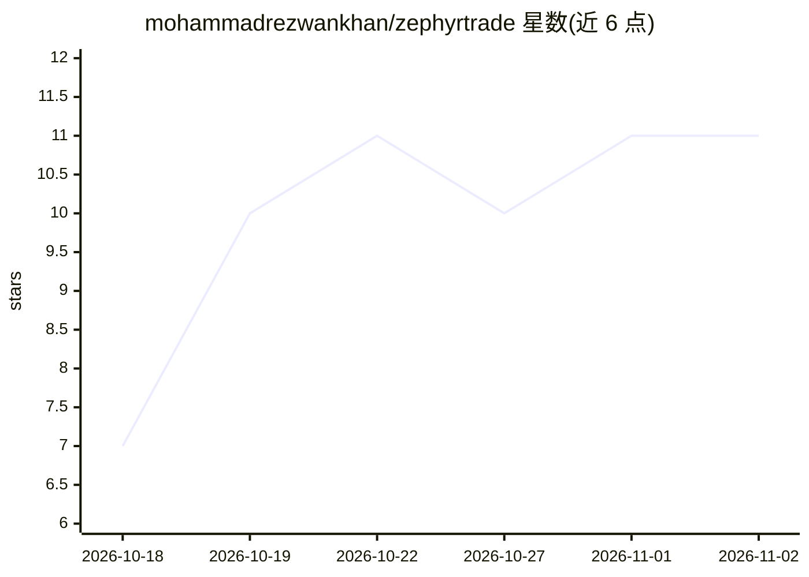

# mohammadrezwankhan/zephyrtrade

⭐ 11 · HTML · MIT · 推送 2026-11-01 · [GitHub](https://github.com/mohammadrezwankhan/zephyrtrade) · [官网](https://mktrade.co.business/) · 个人维护

**风电市场研究的本地交互实验台：合成预测、报价优化与收益回测**

面向风能学生、预测研究者与策略研究开发者的本地研究应用：生成合成风速/气象/价格数据，比较九种风电预测与直接报价策略，回测假设性收益并计算方案报价，不连接实盘。提供三形态：单文件浏览器应用（ZephyrTrade-Champion.html，无需安装）、Node.js 预览脚本、Python 3.11+/SciPy 研究应用（含 loopback API 交叉验证）。保留原 NumPy/pandas/scikit-learn 研究管线与模型输出；数据为 3,888 条小时级合成观测（2024 年），文档明确其非实盘数据、结果不代表可投资绩效，自称本地研究发布候选。

## 筛选速览

| 维度 | 判定 | 备注 |
|---|---|---|
| AI 角色 | `ai-native` | 本体是模型或模型工具 |
| 许可风险 | `permissive` | MIT |
| 部署形态 | `library` | 以包/库形式分发 |
| 模型依赖 | — | README 未给出锁定关系 |
| 硬件要求 | — | 无带数字的原话,不猜 |
| 安装摩擦 | `low` | 无编译、无系统依赖或容器化 |
| 成熟度 | `idea` | |

## 能力要点

- 九种策略对比与假设性报价的收益回测
- 单文件 HTML 便携应用，离线运行、无需安装或账户
- Python/SciPy 线性规划对 JavaScript 报价计算的交叉校验（120 个种子场景误差 <1e-6 DKK）
- 四模块教学路径与模型假设检查点，全部数据为确定性合成仿真

## 适用场景

- 研究风电预测质量与经济价值的分离方法
- 在不同成本假设下回测与比较报价策略
- 教学场景中演示不对称结算与报价优化机制

## 场景标签

`金融量化` · 领域:学习与行业

## 证据(README 行号)

> L67: Research application that generates synthetic wind/weather/price tables, compares wind-forecast and direct-offer st
> L177: The original NumPy/pandas/scikit-learn/SciPy research pipeline, synthetic data,

## 星数曲线

2026-10-18 7 → 2026-11-02 11（+4）

---
*卡片 v1 · prompt 1.4 · 生成 2026-11-02 · 置信度 high · 依据 README sha `9da6cc663cab` · [字段定义](../../DATASET.md)*
