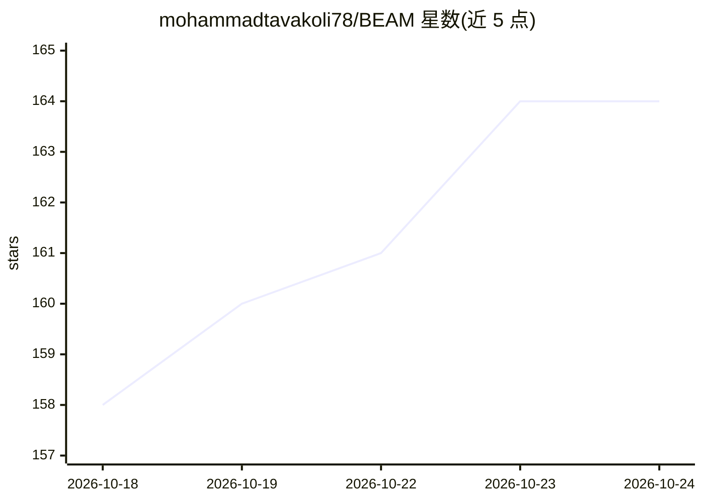

# mohammadtavakoli78/BEAM

⭐ 164 · Python · MIT · 推送 2026-08-31 · [GitHub](https://github.com/mohammadtavakoli78/BEAM) · 个人维护

**LLM 长期记忆评测基准 BEAM 与记忆增强框架 LIGHT（ICLR 2026）**

论文配套仓库，含两部分：BEAM 基准数据集——100 段多尺度对话（128K/500K/1M/10M token），覆盖编程、数学、健康、金融等多领域，配 2,000 道探针问题考察十种记忆能力（弃答、矛盾消解、知识更新、时序推理等）；LIGHT 框架——受人类认知启发的三组件记忆增强推理（情节记忆、工作记忆、暂存便签），实现位于 src/answer_probing_questions/light.py。提供数据自动下载、数据集生成、答案生成与 LLM-as-a-judge 评估的模块化流水线，数据托管于 Hugging Face Hub 并附仓库内副本。代码 MIT 许可，数据另用不同许可。

## 筛选速览

| 维度 | 判定 | 备注 |
|---|---|---|
| AI 角色 | `ai-ecosystem` | LLM/agent 周边工具 |
| 许可风险 | `permissive` | MIT |
| 部署形态 | `library` | 以包/库形式分发 |
| 模型依赖 | — | README 未给出锁定关系 |
| 硬件要求 | — | 无带数字的原话,不猜 |
| 安装摩擦 | `low` | 无编译、无系统依赖或容器化 |
| 成熟度 | — | 结构信号不足 |

## 能力要点

- 100 段对话、四档长度至 10M token、十种记忆能力探针问题
- LIGHT 三组件记忆增强框架（episodic/working/scratchpad）
- 支持自建任意长度多轮对话数据集的三阶段流水线
- LLM-as-a-judge 评估并导出 Excel 报告

## 适用场景

- 评测长上下文 LLM 的长期记忆与长对话推理能力
- 对比长上下文、RAG 基线与 LIGHT 方法的表现
- 生成自定义多领域长对话评测数据集

## 场景标签

`模型评测` `Agent 记忆` · 领域:Agent 开发

## 证据(README 行号)

> L18: Evaluating the abilities of large language models (LLMs) for tasks that require long-term memory and thus long-cont
> L21: BEAM is a comprehensive dataset for evaluating long-term memory in language models. It contains multi-scale convers
> L80: ### 🔬 Evaluation Results

## 星数曲线

2026-10-18 158 → 2026-10-24 164（+6）

---
*卡片 v1 · prompt 1.4 · 生成 2026-10-22 · 置信度 high · 依据 README sha `48e4a5cc672f` · [字段定义](../../DATASET.md)*
