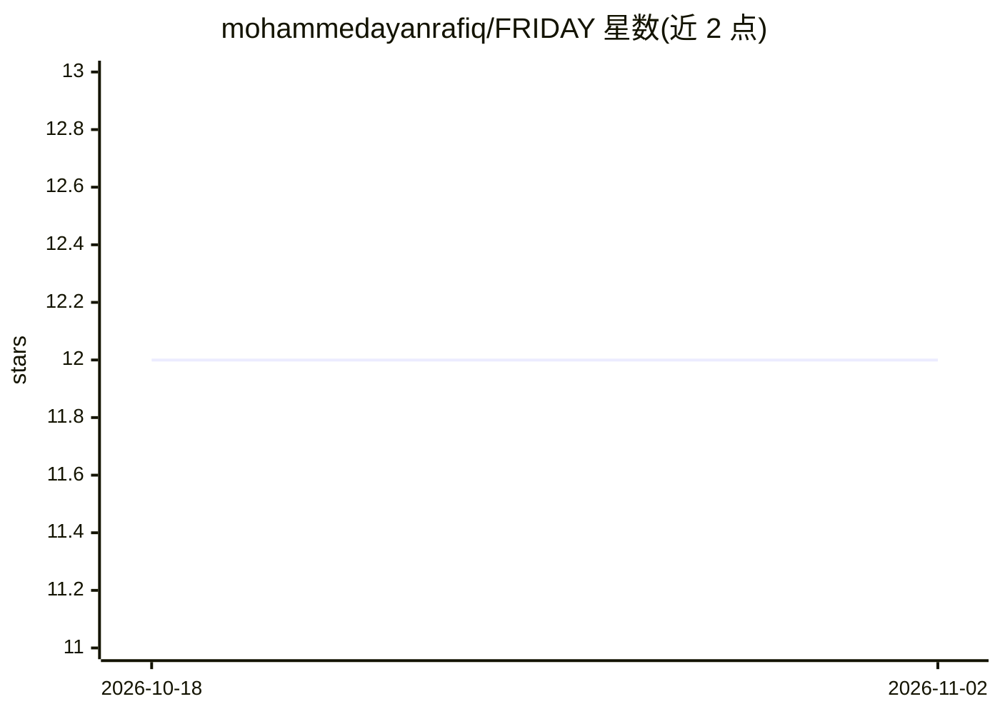

# mohammedayanrafiq/FRIDAY

⭐ 12 · MIT · 推送 2026-04-22 · [GitHub](https://github.com/mohammedayanrafiq/FRIDAY) · 个人维护

**概念展示型语音 AI 助手项目，完整版需联系作者**

受钢铁侠 FRIDAY 启发的个人 AI 助手概念项目，定位为语音交互与智能应答的未来个人 AI 系统愿景。README 仅呈现概念与方向（语音交互、智能响应、自动化可能性），仓库不含可运行的完整实现：无安装说明、无代码使用指引，完整版本与搭建指导需邮件联系作者获取。作者自述为 AI Engineer，仓库处于开发/展示阶段。

## 筛选速览

| 维度 | 判定 | 备注 |
|---|---|---|
| AI 角色 | `ai-native` | 本体是模型或模型工具 |
| 许可风险 | `permissive` | MIT |
| 部署形态 | `None` |  |
| 模型依赖 | — | README 未给出锁定关系 |
| 硬件要求 | — | 无带数字的原话,不猜 |
| 安装摩擦 | `low` | 无编译、无系统依赖或容器化 |
| 成熟度 | `idea` | |

## 能力要点

- 以语音交互与智能应答为核心目标的概念型助手
- 完整实现与搭建指导通过邮件联系作者获取

## 适用场景

- 了解个人语音 AI 助手的项目构想
- 联系作者获取完整版本与定制 AI 助手

## 场景标签

`AI 助手` · 领域:对话与助手

## 证据(README 行号)

> L8: This is a concept and development-level AI Assistant built with the vision of creating a real-time intelligent syste
> L11: - Voice Interaction

## 星数曲线

2026-10-18 12 → 2026-11-02 12（+0）

---
*卡片 v1 · prompt 1.4 · 生成 2026-11-01 · 置信度 mid · 依据 README sha `414b73ba252e` · [字段定义](../../DATASET.md)*
