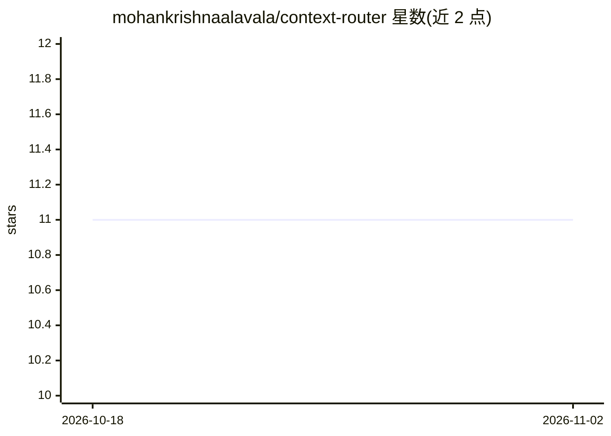

# mohankrishnaalavala/context-router

⭐ 11 · Python · NOASSERTION · 推送 2026-06-12 · [GitHub](https://github.com/mohankrishnaalavala/context-router) · [官网](https://pypi.org/project/context-router-cli/) · 个人维护

**给 AI 编码代理的记忆感知上下文引擎：索引代码并压缩上下文**

面向 AI 编码代理的本地上下文引擎：对代码库建立符号索引，将修复、决策（ADR）等以 markdown 形式存入 .context-router/memory/ 并随 git 共享；通过 17 个 MCP 工具（stdio JSON-RPC 2.0）供 Claude Code、Cursor、Copilot、Gemini CLI、Windsurf 等代理调用，按 review/implement/debug/handover/minimal 五种模式输出限预算的上下文包。支持多仓库工作区、git 钩子自动记录观察、基于反馈的排序调优；可选 cross-encoder 重排与语义检索需额外约 22MB 模型权重。默认支持 Python/TS/Java/C#/YAML/SQL，Go/Rust 等需 tree-sitter 扩展。基准对比 code-review-graph（21 任务）自称端到端 token 减少 96%。

## 筛选速览

| 维度 | 判定 | 备注 |
|---|---|---|
| AI 角色 | `ai-ecosystem` | LLM/agent 周边工具 |
| 许可风险 | `permissive` | NOASSERTION |
| 部署形态 | `library` | 以包/库形式分发 |
| 模型依赖 | locked-api |  |
| 硬件要求 | — | 无带数字的原话,不猜 |
| 安装摩擦 | `low` | 无编译、无系统依赖或容器化 |
| 成熟度 | — | 结构信号不足 |

## 能力要点

- 17 个 MCP 工具，兼容 Claude Code/Cursor/Copilot/Gemini CLI/Windsurf
- 持久化团队记忆（observations + ADR 决策）随 git 共享，无 SaaS 依赖
- 多仓库工作区，从 Python 导入与 OpenAPI/protobuf/GraphQL 契约推断跨仓库边
- 5 种 pack 模式带 token 预算；可选 cross-encoder 重排与语义检索

## 适用场景

- 让编码代理每次会话获得最小可用的代码与记忆上下文
- 团队通过 git 共享 AI 代理积累的修复经验与架构决策
- 跨多仓库工作区生成统一的排序上下文包

## 场景标签

`语义搜索` `Agent 记忆` · 领域:Agent 开发

## 证据(README 行号)

> L9: > **Memory-aware context engine for AI coding agents.**
> L112: context-router exposes **17 MCP tools** over stdio JSON-RPC 2.0.
> L113: Compatible with Claude Code, Cursor, Copilot, Gemini CLI, Windsurf,

## 星数曲线

2026-10-18 11 → 2026-11-02 11（+0）

---
*卡片 v1 · prompt 1.4 · 生成 2026-11-02 · 置信度 high · 依据 README sha `99c444c45617` · [字段定义](../../DATASET.md)*
