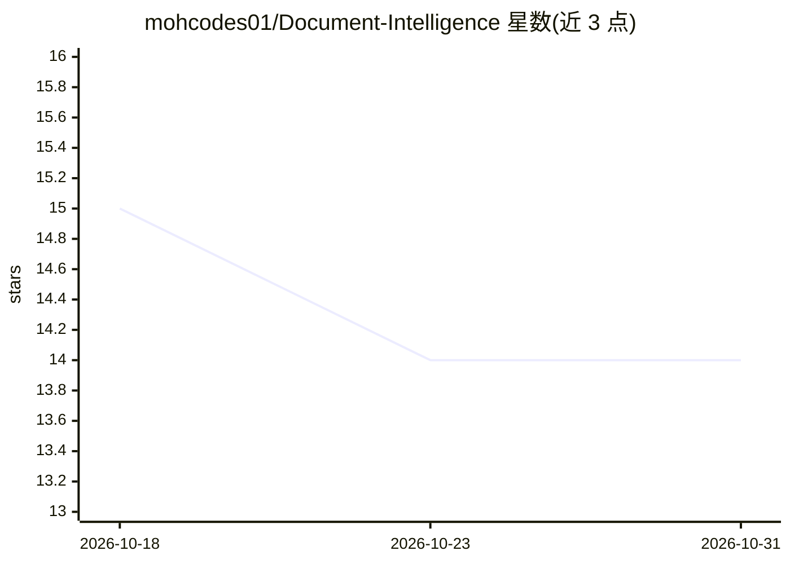

# mohcodes01/Document-Intelligence

⭐ 14 · Python · 推送 2026-07-10 · [GitHub](https://github.com/mohcodes01/Document-Intelligence) · 个人维护

**多文档问答平台：上传文档后获得带引用的回答与主题洞察**

DocMind 是一个基于 RAG 的文档问答平台：用户上传 PDF、图片、Word、TXT 文件后提问，系统经 Tesseract OCR 与 PyMuPDF 提取文本、sentence-transformers 生成嵌入、查询时构建临时 FAISS 索引做语义检索，再经 Groq LLM 生成每篇文档的回答、段落级引用与跨文档主题聚类。后端为 FastAPI，MongoDB 存储元数据，Docker 部署，含每 IP 100 请求/分钟的限流与基于 localStorage 的会话隔离。需自备 GROQ_API_KEY 与 MongoDB 连接串。

## 筛选速览

| 维度 | 判定 | 备注 |
|---|---|---|
| AI 角色 | `ai-native` | 本体是模型或模型工具 |
| 许可风险 | `none` | — |
| 部署形态 | `self-host` | docker 或自建部署 |
| 模型依赖 | locked-api |  |
| 硬件要求 | — | 无带数字的原话,不猜 |
| 安装摩擦 | `low` | 无编译、无系统依赖或容器化 |
| 成熟度 | — | 结构信号不足 |

## 能力要点

- 多格式文档解析：Tesseract OCR 处理扫描件与图片，PyMuPDF/python-docx 处理文本类文档
- RAG 流水线：sentence-transformers 嵌入 + 查询时临时 FAISS 索引 + Groq LLM 生成
- 回答附带段落级引用，跨文档答案聚类为主题
- FastAPI 后端、Docker 部署、SlowAPI 全局限流与会话隔离

## 适用场景

- 上传一批文档并提问，获得逐文档回答与出处引用
- 合规审查、研究综述、运营审计中跨多份文档归纳主题
- 在本地或 Docker 中部署文档问答服务

## 场景标签

`文档问答` `OCR` `文档解析` · 领域:知识与检索

## 证据(README 行号)

> L3: **DocMind** is an intelligent document analysis platform that allows users to upload files, ask questions, and recei
> L145:  - Uses Groq (OpenAI-compatible) to answer a question per document and provide citations

## 星数曲线

2026-10-18 15 → 2026-10-31 14（-1）

---
*卡片 v1 · prompt 1.4 · 生成 2026-10-31 · 置信度 mid · 依据 README sha `7bb6aed649f2` · [字段定义](../../DATASET.md)*
