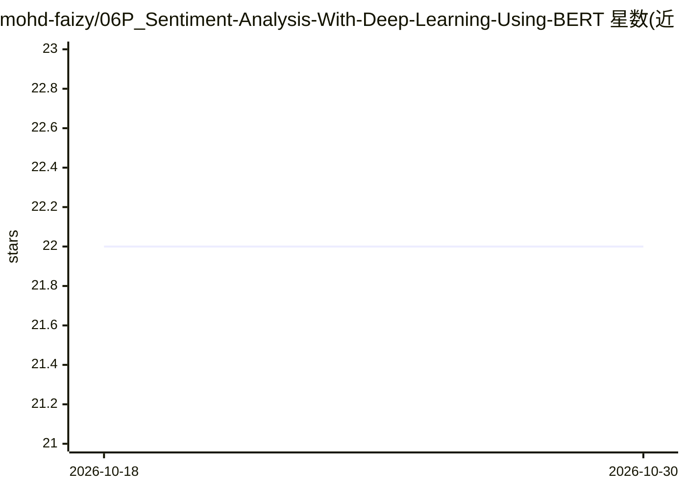

# mohd-faizy/06P_Sentiment-Analysis-With-Deep-Learning-Using-BERT

⭐ 22 · Jupyter Notebook · MIT · 推送 2026-09-13 · [GitHub](https://github.com/mohd-faizy/06P_Sentiment-Analysis-With-Deep-Learning-Using-BERT) · 个人维护

**用 PyTorch 微调 BERT 做推特 6 类情绪分类的教学项目**

基于 Hugging Face Transformers 与 PyTorch 微调 bert-base-uncased（12 层、110M 参数），将推特文本分类到 happy/not-relevant/angry/disgust/sad/surprise 共 6 类情绪。README 按 10 个阶段描述端到端流程：数据清洗与标签编码、85/15 分层切分、WordPiece 分词、BertForSequenceClassification 分类头、DataLoader 等，并附 BERT/Transformer 架构原理讲解。设备分配为 CUDA 可用则用 GPU、否则 CPU，README 未在可见部分给出克隆/运行命令（窗外含源码与 Colab 引用）。

## 筛选速览

| 维度 | 判定 | 备注 |
|---|---|---|
| AI 角色 | `ai-native` | 本体是模型或模型工具 |
| 许可风险 | `permissive` | MIT |
| 部署形态 | `None` |  |
| 模型依赖 | — | README 未给出锁定关系 |
| 硬件要求 | — | 无带数字的原话,不猜 |
| 安装摩擦 | `medium` | 含编译或系统依赖之一 |
| 成熟度 | — | 结构信号不足 |

## 能力要点

- 微调 bert-base-uncased 做 6 类推特情绪分类
- 10 阶段模块化流程：EDA、分层切分、WordPiece 分词、分类头、DataLoader
- CUDA/CPU 动态设备分配
- 附带 BERT 与 Transformer 架构原理讲解

## 适用场景

- 学习 BERT 微调的完整端到端流程
- 作为文本分类任务的代码模板与作业参考
- 了解注意力机制与 BERT 变体知识

## 场景标签

`微调` `教程课程` · 领域:学习与行业

## 证据(README 行号)

> L20: This project demonstrates **fine-tuning a pre-trained BERT model** for multi-class **sentiment analysis** on Twitte
> L228: - **Module**: `BertForSequenceClassification` initializes `bert-base-uncased` with a 6-class linear classification

## 星数曲线

2026-10-18 22 → 2026-10-30 22（+0）

---
*卡片 v1 · prompt 1.4 · 生成 2026-10-27 · 置信度 high · 依据 README sha `95ea096a233c` · [字段定义](../../DATASET.md)*
