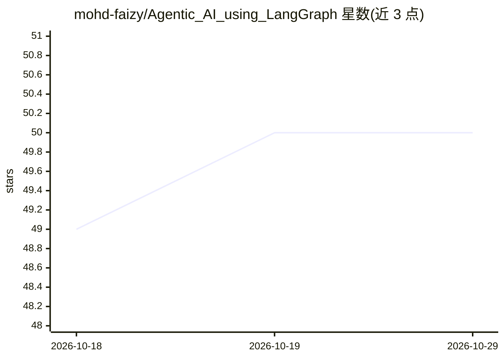

# mohd-faizy/Agentic_AI_using_LangGraph

⭐ 50 · Jupyter Notebook · MIT · 推送 2026-07-18 · [GitHub](https://github.com/mohd-faizy/Agentic_AI_using_LangGraph) · 个人维护

**基于 LangGraph 的 Agentic AI 学习课程与笔记本合集**

由个人维护的 Agentic AI 实践课程仓库：以 LangGraph 为核心框架，按五阶段学习路径（基础、工作流模式、聊天机器人与持久化、工具/MCP/RAG、高级与生产）组织 20 个模块的 Jupyter 笔记本，其中约半数标注待上传。README 给出七组件架构说明（Agents、LangGraph 状态机、MCP 消息层、记忆存储、工具、任务路由、可观测性），以及 uv/pip 两种安装方式和 .env 配置的快速上手流程。技术栈列表列举 LangChain、LangSmith、多家 LLM 提供商及 RAG 组件。

## 筛选速览

| 维度 | 判定 | 备注 |
|---|---|---|
| AI 角色 | `ai-knowledge` | 知识聚合/清单类 |
| 许可风险 | `permissive` | MIT |
| 部署形态 | `None` |  |
| 模型依赖 | local-ok | 支持本地模型 |
| 硬件要求 | — | 无带数字的原话,不猜 |
| 安装摩擦 | `low` | 无编译、无系统依赖或容器化 |
| 成熟度 | — | 结构信号不足 |

## 能力要点

- 五阶段学习路径覆盖 20 个模块（部分待上传）
- 给出七组件 Agentic 架构说明与 GenAI/Agentic AI 对照
- 提供 uv 与 pip 两种安装方式及首个 Agent 示例代码

## 适用场景

- 系统学习 LangGraph 与多 Agent 系统开发
- 按模块练习工作流模式、持久化、RAG 等主题
- 了解 Agentic RAG 与 MCP 的概念与用法

## 场景标签

`教程课程` `RAG` · 领域:知识与检索

## 证据(README 行号)

> L44: > **A comprehensive, hands-on curriculum for mastering Agentic AI** — from foundational concepts to production-grad
> L100: > A comprehensive collection of modules covering the full spectrum of Agentic AI development.

## 星数曲线

2026-10-18 49 → 2026-10-29 50（+1）

---
*卡片 v1 · prompt 1.4 · 生成 2026-10-24 · 置信度 high · 依据 README sha `a1f4c465da64` · [字段定义](../../DATASET.md)*
