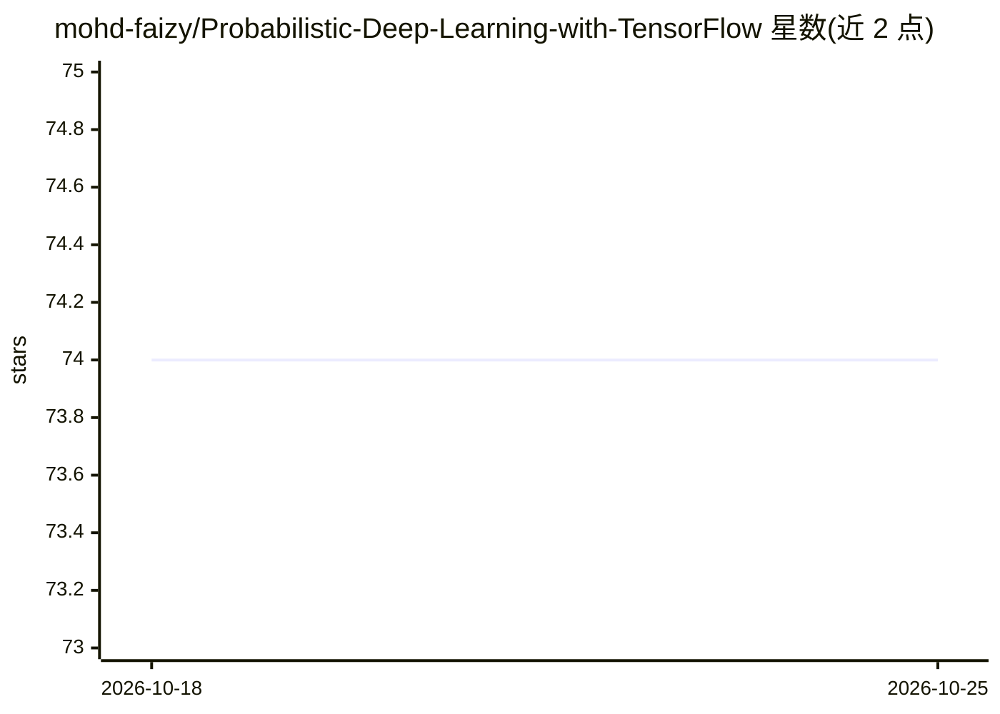

# mohd-faizy/Probabilistic-Deep-Learning-with-TensorFlow

⭐ 74 · Jupyter Notebook · MIT · 推送 2026-06-15 · [GitHub](https://github.com/mohd-faizy/Probabilistic-Deep-Learning-with-TensorFlow) · 个人维护

**TensorFlow Probability 概率深度学习教学代码与笔记本合集**

个人维护的教学向代码仓库，汇集 TensorFlow Probability（TFP）的概率深度学习实现：按离散/连续/多元分类讲解 Bernoulli、Binomial、Poisson、Gaussian、Beta 等分布的数学公式与 TFP 代码，并附按难度分级（初级/中级）的 notebook 系列。内容覆盖贝叶斯神经网络、变分推断、归一化流、密度估计与不确定性量化，运行需 Python 3.8+ 与 TensorFlow/Keras 基础。安装方式为 git clone 后用 uv 建虚拟环境并装 requirements.txt。

## 筛选速览

| 维度 | 判定 | 备注 |
|---|---|---|
| AI 角色 | `ai-knowledge` | 知识聚合/清单类 |
| 许可风险 | `permissive` | MIT |
| 部署形态 | `library` | 以包/库形式分发 |
| 模型依赖 | — | README 未给出锁定关系 |
| 硬件要求 | — | 无带数字的原话,不猜 |
| 安装摩擦 | `low` | 无编译、无系统依赖或容器化 |
| 成熟度 | — | 结构信号不足 |

## 能力要点

- 按数学类型组织的 TFP 分布速查表与逐个实现讲解
- 覆盖贝叶斯神经网络、变分推断、归一化流等主题的 notebook 系列（按难度分级）
- 给出各分布在深度学习中的典型用途（如 BNN 先验、VAE 潜空间、泊松回归）

## 适用场景

- 系统学习 TensorFlow Probability 的分布 API 与概率建模
- 查阅概率分布的数学公式、参数与 TFP 对应类
- 按难度递进练习概率深度学习 notebook

## 场景标签

`教程课程` · 领域:学习与行业

## 证据(README 行号)

> L23: This repository is a comprehensive collection of **TensorFlow Probability** implementations for probabilistic deep 
> L313: ### Comprehensive Notebook Collection

## 星数曲线

2026-10-18 74 → 2026-10-25 74（+0）

---
*卡片 v1 · prompt 1.4 · 生成 2026-10-24 · 置信度 mid · 依据 README sha `6e30258372b9` · [字段定义](../../DATASET.md)*
