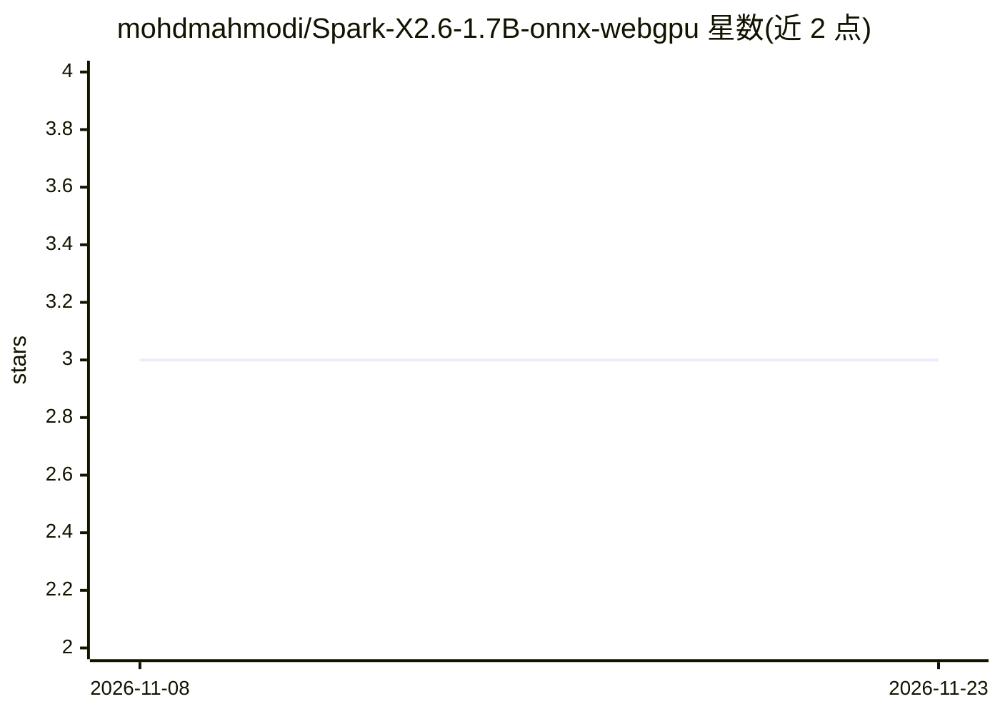

# mohdmahmodi/Spark-X2.6-1.7B-onnx-webgpu

⭐ 3 · Python · Apache-2.0 · 推送 2026-10-31 · [GitHub](https://github.com/mohdmahmodi/Spark-X2.6-1.7B-onnx-webgpu) · [官网](https://huggingface.co/spaces/mohdmahmodi/Spark-X2.6-1.7B-WebGPU) · 个人维护

**在浏览器中用 WebGPU 运行 Spark-X2.6-1.7B 的 4-bit ONNX 构建**

将 XHToken 的 Spark-X2.6-1.7B（1.7B 参数）转换为 4-bit ONNX 格式，完全在浏览器 WebGPU 上运行，无服务器、数据不出设备。包含一个聊天应用与可复用的 JavaScript 加载器（spark.js、chat.js、toolcall.js，纯 ES 模块），支持官方聊天模板、思考开关、多轮 prompt-cache 复用与工具调用。附验证报告：GSM8K/BFCL/大海捞针与官方 INT4 权重在 transformers 中结果一致，约 105 tok/s 解码。限制：仅支持 Chrome/Edge 113+ 桌面版 WebGPU，WASM CPU 后端不支持。

## 筛选速览

| 维度 | 判定 | 备注 |
|---|---|---|
| AI 角色 | `ai-native` | 本体是模型或模型工具 |
| 许可风险 | `permissive` | Apache-2.0 |
| 部署形态 | `library` | 以包/库形式分发 |
| 模型依赖 | — | README 未给出锁定关系 |
| 硬件要求 | `gpu-8g` | |
| 安装摩擦 | `low` | 无编译、无系统依赖或容器化 |
| 成熟度 | — | 结构信号不足 |

## 能力要点

- 4-bit ONNX 构建与官方 INT4 权重逐张量核对一致
- 静态 KV cache 常驻 GPU，多轮对话复用前缀缓存
- 提供纯 ES 模块的 JavaScript 加载器，兼容 Transformers.js 4.3 加载
- 开源工具链：从 safetensors 导出 ONNX 并附验证脚本

## 适用场景

- 在浏览器中本地运行 1.7B 聊天模型，数据不上传
- 在自己的网页中嵌入本地 LLM 推理与工具调用解析
- 对比量化 ONNX 构建与原始权重的精度与速度

## 场景标签

`聊天机器人` `模型量化` · 领域:对话与助手

## 证据(README 行号)

> L11: Spark-X2.6-1.7B in the browser
> L14: converted to 4-bit ONNX and running entirely in the browser on WebGPU. No server, no install, no data leaves the de

## 星数曲线

2026-11-08 3 → 2026-11-23 3（+0）

---
*卡片 v1 · prompt 1.4 · 生成 2026-11-21 · 置信度 high · 依据 README sha `05cbb5e3bd9c` · [字段定义](../../DATASET.md)*
