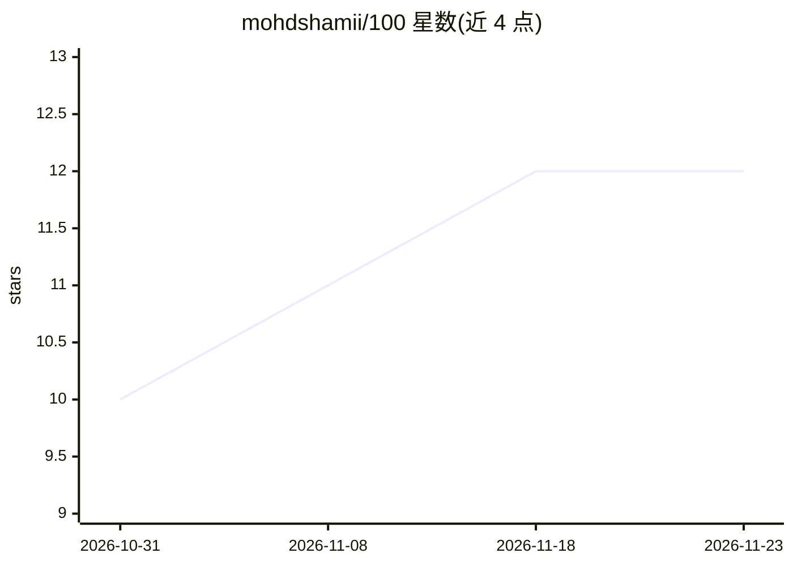

# mohdshamii/100

⭐ 12 · JavaScript · 推送 2026-11-16 · [GitHub](https://github.com/mohdshamii/100) · [官网](https://mohdshamii.github.io/100/) · 个人维护

**AI/ML 工程自学课程清单：9 个百项列表+路线图**

自包含的 AI/ML 工程课程合集，收录 100 篇论文、100 本书、100 个数据集、100 个项目想法、100 个工具、100 道面试题、100 门课程、100 个博客/人物、100 个术语，外加统一路线图、公式速查表与贡献指南。每个列表按入门到进阶组织，条目含标题、作者与链接，底部附学习路径建议；主路线图按周编排，从数学与经典 ML 到深度学习、专业方向（NLP/CV/RL）再到 LLM/RAG/MLOps。

## 筛选速览

| 维度 | 判定 | 备注 |
|---|---|---|
| AI 角色 | `ai-knowledge` | 知识聚合/清单类 |
| 许可风险 | `none` | — |
| 部署形态 | `None` |  |
| 模型依赖 | — | README 未给出锁定关系 |
| 硬件要求 | — | 无带数字的原话,不猜 |
| 安装摩擦 | `low` | 无编译、无系统依赖或容器化 |
| 成熟度 | — | 结构信号不足 |

## 能力要点

- 9 个百项列表覆盖论文/书籍/数据集/项目/工具/面试题/课程/博客/术语
- 统一 ROADMAP.md 按周编排跨文件学习顺序
- 列表按 beginner → advanced 组织，条目含标题/作者/链接与学习周期建议
- 附公式速查表与 changelog

## 适用场景

- 按周计划自学 AI/ML 工程
- 准备 AI/ML 岗位面试题
- 为课程或项目挑选入门到进阶的数据集与论文

## 场景标签

`教程课程` `精选清单` · 领域:学习与行业

## 证据(README 行号)

> L3: A complete, self-contained curriculum for AI/ML engineering — 100 research papers, 100 books, 100 datasets, 100 proj
> L9: All files follow the same structure:

## 星数曲线

2026-10-31 10 → 2026-11-23 12（+2）

---
*卡片 v1 · prompt 1.4 · 生成 2026-11-18 · 置信度 high · 依据 README sha `495acc263c80` · [字段定义](../../DATASET.md)*
