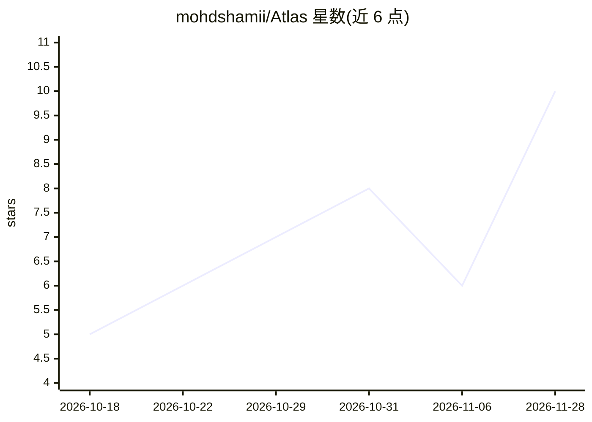

# mohdshamii/Atlas

⭐ 10 · HTML · 推送 2026-10-22 · [GitHub](https://github.com/mohdshamii/Atlas) · 个人维护

**印度北方邦 civic/地理数据可视化与分析平台**

以 Flask + Jupyter 构建的印度公民与地理数据可视化平台，覆盖北方邦 75 个县 2015–2024 年 11 类指标，并扩展至 2025–2030 预测。核心机制包括基于 FNV-1a/Mulberry32 的确定性 PRNG 数据生成（无需数据库）、K-Means 社会经济聚类、PCA 降维、Ridge 回归时序预测与预算优化模拟；前端用 Three.js/Leaflet/Plotly 渲染，提供 12 个 REST API 端点、CSV 导出与 Jupyter 研究流程。README 说明当前 V1 数据为合成生成并标注来源状态。

## 筛选速览

| 维度 | 判定 | 备注 |
|---|---|---|
| AI 角色 | `ai-native` | 本体是模型或模型工具 |
| 许可风险 | `none` | — |
| 部署形态 | `library` | 以包/库形式分发 |
| 模型依赖 | — | README 未给出锁定关系 |
| 硬件要求 | — | 无带数字的原话,不猜 |
| 安装摩擦 | `low` | 无编译、无系统依赖或容器化 |
| 成熟度 | — | 结构信号不足 |

## 能力要点

- K-Means 聚类（k=4）划分 4 个发展层级与 PCA 二维散点可视化
- Ridge 回归生成 2025–2030 预测及 95% 置信区间
- 12 个 CORS 开放的 REST API 端点与动态 CSV 导出
- 确定性 PRNG 使 42,750+ 数据点完全可复现

## 适用场景

- 按县对比北方邦各发展指标与排名
- 运行端到端聚类与预测的机器学习分析流程
- 通过 API 获取时间序列与聚类数据进行研究
- 模拟多年期多部门预算干预的政策影响

## 场景标签

`数据分析` · 领域:效率与自动化

## 证据(README 行号)

> L16: ### 2. Scikit-Learn Machine Learning & Econometric Core (`core/ml_engine.py`)
> L17: - **K-Means Socio-Economic Clustering ($k=4$)**:
> L26:  - Employs **Ridge Regression with L2 Regularization** trained on historical indicators (2015–2024).

## 星数曲线

2026-10-18 5 → 2026-11-28 10（+5）

---
*卡片 v1 · prompt 1.4 · 生成 2026-11-28 · 置信度 high · 依据 README sha `107040f59cee` · [字段定义](../../DATASET.md)*
