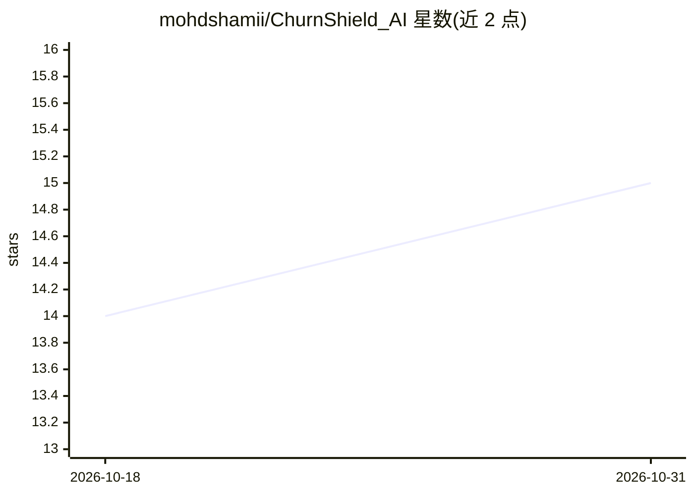

# mohdshamii/ChurnShield_AI

⭐ 15 · Jupyter Notebook · 推送 2026-10-28 · [GitHub](https://github.com/mohdshamii/ChurnShield_AI) · 个人维护

**电信客户流失预测系统：多模型集成与挽留策略推荐**

面向企业客户的流失（churn）预测系统：使用 XGBoost、Random Forest、Logistic Regression 组成的多模型集成预测客户流失概率，附 SHAP 可解释性分析与 Streamlit 交互仪表盘，展示风险分层客户分群、客户终身价值保留估算与挽留 ROI 计算器；另提供个性化干预建议、邮件/短信活动模板与赢回激励模拟。技术栈为 Python 3.10、XGBoost 1.7、Scikit-learn 1.2、Streamlit 1.22，通过克隆源码运行，本地 8501 端口访问。

## 筛选速览

| 维度 | 判定 | 备注 |
|---|---|---|
| AI 角色 | `ai-native` | 本体是模型或模型工具 |
| 许可风险 | `none` | — |
| 部署形态 | `None` |  |
| 模型依赖 | — | README 未给出锁定关系 |
| 硬件要求 | — | 无带数字的原话,不猜 |
| 安装摩擦 | `low` | 无编译、无系统依赖或容器化 |
| 成熟度 | — | 结构信号不足 |

## 能力要点

- XGBoost + Random Forest + Logistic Regression 多模型集成预测
- SHAP 可解释性风险评分
- 客户风险分群与挽留 ROI 计算器
- 邮件/短信挽留活动模板与赢回激励模拟

## 适用场景

- 识别有流失风险的客户并查看概率评分
- 按风险分层制定挽留干预策略
- 在仪表盘中分析流失数据并估算挽留 ROI

## 场景标签

`数据分析` · 领域:效率与自动化

## 证据(README 行号)

> L5: ChurnShield AI is an AI-powered customer churn prediction system that helps businesses identify customers at risk of
> L20: - **Multi-model ensemble** (XGBoost + Random Forest + Logistic Regression)

## 星数曲线

2026-10-18 14 → 2026-10-31 15（+1）

---
*卡片 v1 · prompt 1.4 · 生成 2026-10-30 · 置信度 high · 依据 README sha `8fb0a1cf2c96` · [字段定义](../../DATASET.md)*
