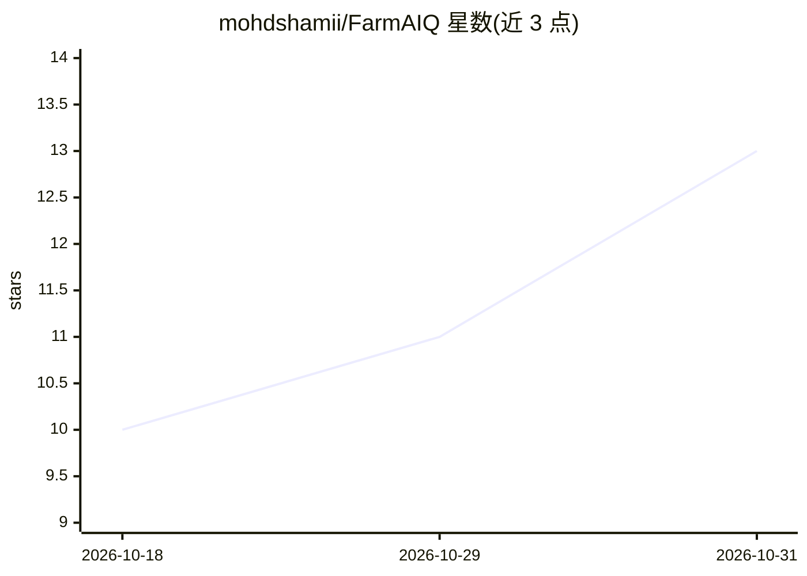

# mohdshamii/FarmAIQ

⭐ 13 · Jupyter Notebook · 推送 2026-10-21 · [GitHub](https://github.com/mohdshamii/FarmAIQ) · 个人维护

**面向印度小农的精准农业决策平台：作物推荐、病害诊断、市场行情**

基于 Flask 的精准农业决策 Web 应用，面向印度小农户、农学家与农技推广人员，整合八个模块：Random Forest 作物适宜性推荐、NPK 缺口与商品肥料袋数计算、ResNet9 卷积网络（PlantVillage 数据集）叶片病害诊断、产量预测、FAO-56 灌溉调度、APMC 市场 MSP 行情、土壤健康评分与政府补贴方案目录。提供 REST API 供移动应用与 IoT 传感器集成。安装方式为 git clone 后 pip 安装依赖并运行 Flask，附带 21 个单元/集成测试。

## 筛选速览

| 维度 | 判定 | 备注 |
|---|---|---|
| AI 角色 | `ai-native` | 本体是模型或模型工具 |
| 许可风险 | `none` | — |
| 部署形态 | `library` | 以包/库形式分发 |
| 模型依赖 | — | README 未给出锁定关系 |
| 硬件要求 | — | 无带数字的原话,不猜 |
| 安装摩擦 | `low` | 无编译、无系统依赖或容器化 |
| 成熟度 | — | 结构信号不足 |

## 能力要点

- Random Forest（集成 100 棵树）作物推荐，README 报告 99.55% 测试准确率
- ResNet9（6.58M 参数，PyTorch）叶片病害诊断，报告 98.24% 验证准确率与 CPU 推理 <50ms
- NPK 缺口换算为具体商品肥料袋数（尿素/DAP/MOP）与施肥日程
- 提供作物推荐、肥料建议、市场行情等 JSON REST API 端点

## 适用场景

- 输入土壤养分与气象数据获取推荐作物及置信度
- 上传叶片图像获取病害诊断与化学/有机防治方案
- 查询各邦 APMC 市场价与 MSP 价差以决定出售或仓储
- 通过 API 将农艺决策集成到移动应用或 IoT 土壤传感器系统

## 场景标签

`目标检测` `数据分析` · 领域:效率与自动化

## 证据(README 行号)

> L15: 1. **Multi-Factor Crop Suitability Recommendation** (99.5% accuracy via Random Forest ensemble)
> L17: 3. **Deep Learning Plant Disease Pathology Diagnosis** (ResNet9 CNN on PlantVillage dataset)
> L51: - **Architecture**: Residual Convolutional Neural Network (PyTorch ResNet9).

## 星数曲线

2026-10-18 10 → 2026-10-31 13（+3）

---
*卡片 v1 · prompt 1.4 · 生成 2026-10-31 · 置信度 mid · 依据 README sha `5905f25faf54` · [字段定义](../../DATASET.md)*
