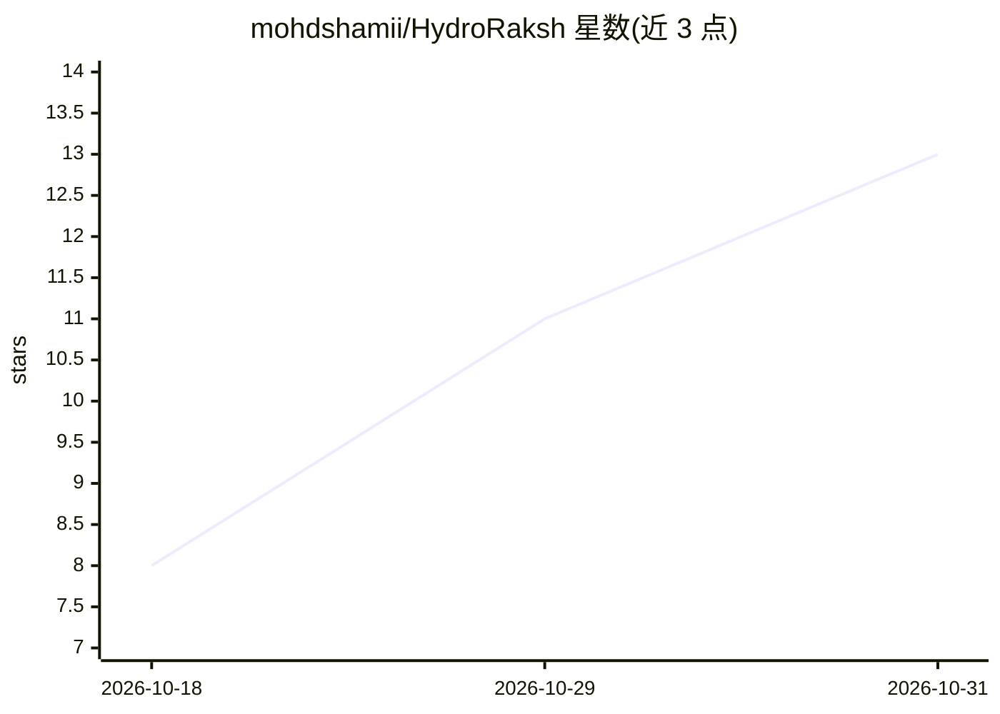

# mohdshamii/HydroRaksh

⭐ 13 · Python · 推送 2026-10-27 · [GitHub](https://github.com/mohdshamii/HydroRaksh) · 个人维护

**面向印度的 AI 地下水智能与水资源决策支持平台**

覆盖印度 36 个邦/联邦领土、700+ 地区的地下水智能 Web 平台（Flask+FastAPI）：汇集 CGWB、IMD、India-WRIS、CWC 等公开数据，提供水位多时间尺度预测（随机森林/梯度提升）、HG-CF 干预措施推荐（图拉普拉斯正则的协同过滤）、LDA 主题挖掘、水量平衡审计、补给工程 sizing、预算优化与 what-if 模拟等 17 个模块；附 16 个 Jupyter 研究工作流与 Docker 部署。由个人研究者（B.Tech Data Science 学生）维护，声明非官方政府网站，IoT 端点为模拟边缘、MODFLOW 耦合为规划中。

## 筛选速览

| 维度 | 判定 | 备注 |
|---|---|---|
| AI 角色 | `ai-native` | 本体是模型或模型工具 |
| 许可风险 | `none` | — |
| 部署形态 | `self-host` | docker 或自建部署 |
| 模型依赖 | — | README 未给出锁定关系 |
| 硬件要求 | — | 无带数字的原话,不猜 |
| 安装摩擦 | `low` | 无编译、无系统依赖或容器化 |
| 成熟度 | — | 结构信号不足 |

## 能力要点

- 水位多时间尺度预测：滚动交叉验证下 Ridge MAE 3.85m
- HG-CF 干预推荐：融合水文地质属性的图拉普拉斯正则协同过滤
- 17 个平台模块：水量平衡、补给 sizing、预算优化、what-if 模拟等
- 16 个 Jupyter 研究工作流 + 101 个单元测试 + Docker 部署

## 适用场景

- 查看全印度各区地下水深度与水质趋势并做对比
- 为数据稀疏区块获取补给干预措施推荐
- 在预算约束下优化水资源工程投资分配
- 运行 what-if 情景模拟抽取/降雨/补给压力测试

## 场景标签

`数据分析` · 领域:效率与自动化

## 证据(README 行号)

> L3: **AI-driven groundwater intelligence and water resource decision support for India.**
> L25: - **Hydro-Geological Collaborative Filtering (HG-CF):** Recommends interventions for data-sparse blocks by embeddin
> L119: |ML Forecaster|Multi-horizon forecasting (random forest, gradient boosting)|Implemented|

## 星数曲线

2026-10-18 8 → 2026-10-31 13（+5）

---
*卡片 v1 · prompt 1.4 · 生成 2026-10-31 · 置信度 high · 依据 README sha `80e1fcd55b9e` · [字段定义](../../DATASET.md)*
