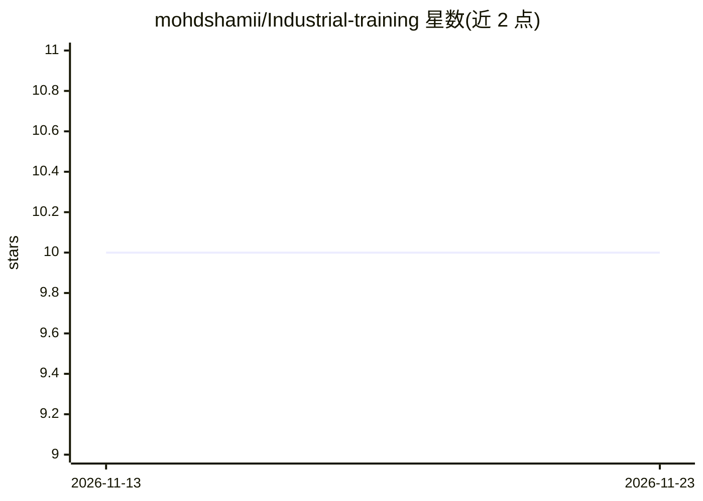

# mohdshamii/Industrial-training

⭐ 10 · Jupyter Notebook · 推送 2026-11-18 · [GitHub](https://github.com/mohdshamii/Industrial-training) · 个人维护

**工业实训期间的 18 个 Python/ML/Web 学习项目合集**

一名学生整理的实训项目作品集：18 个子项目覆盖医院管理系统、密码管理器、报表生成等应用，以及信用卡欺诈检测、客户流失预测、客户分群、垃圾邮件分类、房价/泰坦尼克预测、鸢尾花分类等机器学习任务，另有 NLP/实时聊天机器人、天气看板与 Zomato 数据分析。技术栈为 Python、scikit-learn、Pandas/NumPy、NLTK/spaCy、Flask、Streamlit 及 HTML/CSS/JavaScript。各项目文件夹含源码、文档、数据集与运行说明；仓库以克隆方式浏览。

## 筛选速览

| 维度 | 判定 | 备注 |
|---|---|---|
| AI 角色 | `ai-knowledge` | 知识聚合/清单类 |
| 许可风险 | `none` | — |
| 部署形态 | `None` |  |
| 模型依赖 | — | README 未给出锁定关系 |
| 硬件要求 | — | 无带数字的原话,不猜 |
| 安装摩擦 | `low` | 无编译、无系统依赖或容器化 |
| 成熟度 | — | 结构信号不足 |

## 能力要点

- 18 个覆盖 ML、数据分析、Web 与 Python 应用的子项目
- 机器学习项目含分类、回归、聚类任务（随机森林/XGBoost 等标签）
- 每个项目文件夹含源码、文档、数据集与运行说明

## 适用场景

- 查找常见 ML 入门任务（欺诈检测/流失预测/房价预测）的参考实现
- 了解机器学习项目的完整工作流示例
- 浏览学生实训项目的技术栈组合

## 场景标签

`数据分析` `聊天机器人` `教程课程` · 领域:效率与自动化

## 证据(README 行号)

> L1: # INDUSTRIAL TRAINING PROJECT COLLECTION
> L3: This repository contains a comprehensive collection of projects developed during my Industrial Training Program. Thr
> L9: ## DETAILED PROJECT DESCRIPTIONS

## 星数曲线

2026-11-13 10 → 2026-11-23 10（+0）

---
*卡片 v1 · prompt 1.4 · 生成 2026-11-19 · 置信度 high · 依据 README sha `87067e11571e` · [字段定义](../../DATASET.md)*
