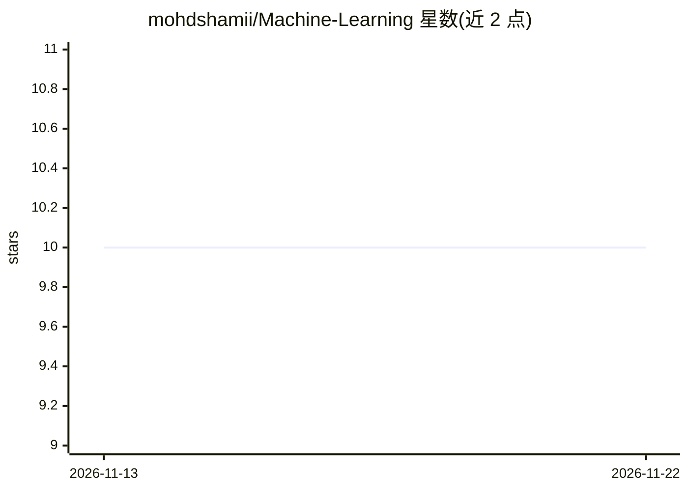

# mohdshamii/Machine-Learning

⭐ 10 · Jupyter Notebook · 推送 2026-10-20 · [GitHub](https://github.com/mohdshamii/Machine-Learning) · [官网](https://mohdshamii.github.io/Machine-Learning) · 个人维护

**面向学生与初学者的机器学习交互式学习站点**

MLVault 是一个基于 React、Vite 和 TypeScript 构建的静态机器学习学习平台，可部署到 GitHub Pages。它以 Jupyter 风格界面渲染 .ipynb 笔记与 Markdown/PDF 学习资料，内置 21 个主题的课程结构（从 Python 与数学基础到 Transformers、MLOps、GATE DA 复习）、Ctrl+K 全局模糊搜索、闪卡与选择题练习、进度跟踪与书签、面试题与公式速查表。内容通过自动发现脚本索引，新增资料无需改代码；部署由 GitHub Actions 自动构建。

## 筛选速览

| 维度 | 判定 | 备注 |
|---|---|---|
| AI 角色 | `ai-knowledge` | 知识聚合/清单类 |
| 许可风险 | `none` | — |
| 部署形态 | `library` | 以包/库形式分发 |
| 模型依赖 | — | README 未给出锁定关系 |
| 硬件要求 | — | 无带数字的原话,不猜 |
| 安装摩擦 | `low` | 无编译、无系统依赖或容器化 |
| 成熟度 | — | 结构信号不足 |

## 能力要点

- Jupyter 风格 UI 原生渲染 .ipynb（含 Markdown、代码、Matplotlib/Seaborn 图、DataFrame）
- 21 个主题的结构化课程与自动内容发现索引机制
- Ctrl+K 全局模糊搜索、闪卡、MCQ 练习与 localStorage 进度跟踪
- GitHub Actions 自动部署到 GitHub Pages

## 适用场景

- 系统学习机器学习核心概念与算法
- 备考 GATE Data Science & AI 并复习公式
- 刷机器学习面试题与避坑清单
- 托管和浏览自己的学习笔记与 Jupyter 笔记本

## 场景标签

`教程课程` · 领域:学习与行业

## 证据(README 行号)

> L1: # MLVault - Machine Learning tutorial plateform
> L16:  - Structured modular curriculum from Python & Math foundations to Transformers, MLOps, and GATE DA revision.

## 星数曲线

2026-11-13 10 → 2026-11-22 10（+0）

---
*卡片 v1 · prompt 1.4 · 生成 2026-11-19 · 置信度 high · 依据 README sha `f08f3a158734` · [字段定义](../../DATASET.md)*
