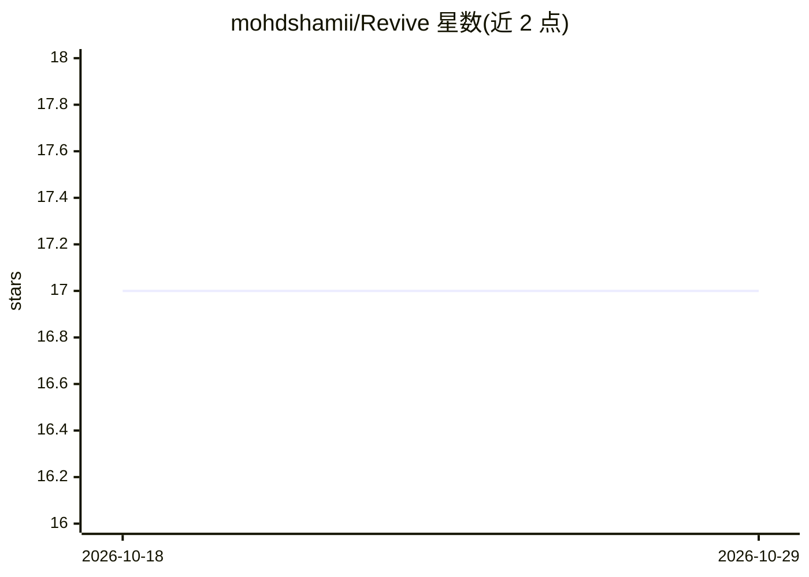

# mohdshamii/Revive

⭐ 17 · Jupyter Notebook · 推送 2026-10-21 · [GitHub](https://github.com/mohdshamii/Revive) · 个人维护

**多模态临床辅助诊断平台：8 种疾病的机器学习风险分层**

用 Python/Flask/Scikit-learn/TensorFlow 构建的多模态临床决策支持系统：对表格型生理指标用随机森林（100 棵树）分类，对疟疾血涂片显微图像与儿童肺炎胸片用 CNN 做图像诊断，共覆盖糖尿病、乳腺癌、心脏病、慢性肾病、肝病、脑卒中等 8 个病理模块。内置 Jupyter Notebook 风格的浏览器内训练/测试/评估流水线，支持超参数调优、混淆矩阵与 ROC-AUC 分析；含中位数填补、类别编码和 Z-score 标准化的预处理管线。各模块在公开基准数据集上报告了留出集测试准确率。

## 筛选速览

| 维度 | 判定 | 备注 |
|---|---|---|
| AI 角色 | `ai-native` | 本体是模型或模型工具 |
| 许可风险 | `none` | — |
| 部署形态 | `library` | 以包/库形式分发 |
| 模型依赖 | — | README 未给出锁定关系 |
| 硬件要求 | — | 无带数字的原话,不猜 |
| 安装摩擦 | `low` | 无编译、无系统依赖或容器化 |
| 成熟度 | — | 结构信号不足 |

## 能力要点

- 8 个病理模块的表格+影像双模态诊断
- 随机森林（100 树）处理表格指标，CNN 处理显微图像与胸片
- 浏览器内训练/测试/评估流水线，支持混淆矩阵与 ROC-AUC
- 自动预处理：训练分区中位数填补、类别编码、Z-score 标准化

## 适用场景

- 临床分诊场景对患者做快速风险分层打分
- 数据科学家在浏览器内复现训练与评估流程
- 对比多个公开临床数据集上的分类效果

## 场景标签

 · 领域:医疗健康/临床辅助诊断

## 证据(README 行号)

> L14: **Revive** is an enterprise-grade, multi-modal clinical decision support system (CDSS) uniting tabular physiologica
> L24: In addition to point-of-care patient risk scoring, Revive integrates an interactive Jupyter Notebook-themed pipelin

## 星数曲线

2026-10-18 17 → 2026-10-29 17（+0）

---
*卡片 v1 · prompt 1.4 · 生成 2026-10-29 · 置信度 high · 依据 README sha `f7895d166746` · [字段定义](../../DATASET.md)*
