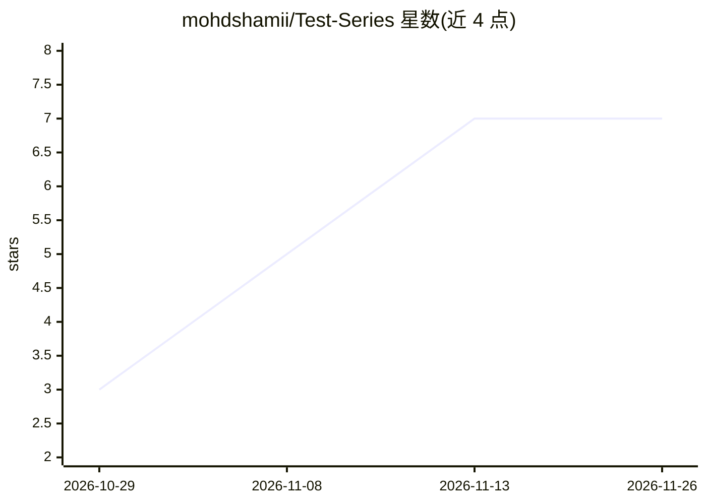

# mohdshamii/Test-Series

⭐ 7 · TypeScript · 推送 2026-11-04 · [GitHub](https://github.com/mohdshamii/Test-Series) · [官网](https://mohdshamii.github.io/Test-Series) · 个人维护

**为 GATE DA 考生提供纯前端在线模拟考试与题库**

面向 GATE 数据科学与人工智能（DA）考生的在线考试平台，100% 静态运行于浏览器，无后端服务器。包含 25 套全真模拟卷（含 2024/2025 官方真题）与 75 套分科/分章测试，覆盖官方 8 大科目 41 章。实现 IIT GATE CBT 界面仿真：五态题板、屏幕科学计算器、键盘快捷键、计时器在刷新后保留；按官方规则评分（MCQ 负分、MSQ/NAT 零负分）。题库为结构化 JSON，带校验命令；进度存于 localStorage 并可导出/导入 JSON。

## 筛选速览

| 维度 | 判定 | 备注 |
|---|---|---|
| AI 角色 | `ai-knowledge` | 知识聚合/清单类 |
| 许可风险 | `none` | — |
| 部署形态 | `library` | 以包/库形式分发 |
| 模型依赖 | — | README 未给出锁定关系 |
| 硬件要求 | — | 无带数字的原话,不猜 |
| 安装摩擦 | `low` | 无编译、无系统依赖或容器化 |
| 成熟度 | — | 结构信号不足 |

## 能力要点

- 100 套测试：25 套全真模拟 + 75 套分科/分章练习，覆盖 8 科 41 章
- GATE CBT 界面仿真：五态题板、虚拟科学计算器、刷新后保留计时
- 按官方规则评分（MCQ 负分 / MSQ、NAT 零负分 / NAT 区间给分）
- 结构化 JSON 题库，提供 schema 校验命令与 GitHub Pages 自动部署

## 适用场景

- 备考 GATE DA 做全真计时模拟
- 按章节专项刷题并查看成绩分析
- 离线/低带宽环境下在浏览器中练习

## 场景标签

 · 领域:教育/考试备考

## 证据(README 行号)

> L3: > A production-ready, client-side online examination and test series platform built exclusively for **GATE Data Scie
> L14: - **Zero Paid Server Backend**: Runs 100% statically in any modern desktop or mobile browser.
> L32: The platform covers 100% of the official GATE DA examination syllabus across 8 core subjects and 41 chapters:

## 星数曲线

2026-10-29 3 → 2026-11-26 7（+4）

---
*卡片 v1 · prompt 1.4 · 生成 2026-11-20 · 置信度 high · 依据 README sha `44ab779f1235` · [字段定义](../../DATASET.md)*
